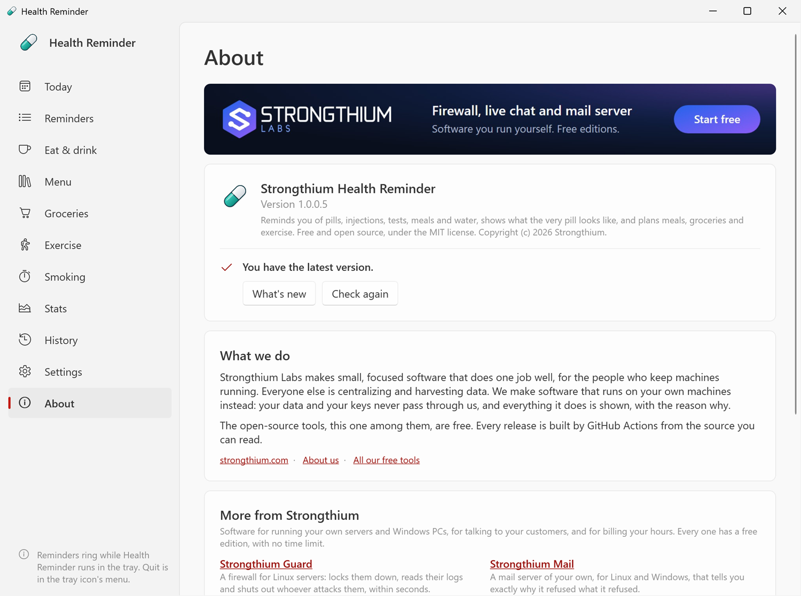

  

[health-reminder](../README.md) › [Manual](README.md) › About

# About

The last page down the side: who makes `health-reminder`, which version this is and whether there's a newer one, and
what else Strongthium makes.

## The banner

Strongthium Labs' banner. A click opens [strongthium.com](https://strongthium.com).

## Strongthium Health Reminder

The program's icon and name, **Version 1.0.0.5**, and what it does: it reminds you of pills, injections, tests, meals
and water, shows what the very pill looks like, and plans meals, groceries and exercise. Free and open source, under
the MIT license.

Under it, the update check. When the page is opened, it asks GitHub for the latest release: **Asking GitHub for the
latest version…**, then:

| | |
|---|---|
| **You have the latest version.** | |
| **Version 1.0.0.6 is out. You have 1.0.0.5.** | **Update to 1.0.0.6 and restart** downloads it from GitHub, checks it against the release's checksums, replaces this program and starts it again. Your reminders and history stay as they are |
| **This is newer than the latest release, …** | a build of your own |
| **Couldn't ask GitHub for the latest version** | with why: no connection, **GitHub took too long to answer.**, **GitHub has had too many questions from this address for now. Try again in an hour.** |
| **The update wasn't installed** | with why, and **You can download it from the release's page instead: What's new.** If the program's folder needs an administrator to change it: **This program can't be replaced from here: … needs an administrator to change it.** |

| | |
|---|---|
| **What's new** | opens the release's page on GitHub |
| **Check again** | asks again |

GitHub is asked only when About is opened, again if it's still open an hour later, or when **Check again** is pressed.
`api.github.com` sees that the question came from your address, and which program and version asked; nothing of yours
is sent. Nothing is installed until **Update** is pressed.

The update checks the download against the release's `SHA256SUMS`: if it doesn't match, **nothing was changed**. The
checksums come with the release, so they catch a damaged download, not a tampered release. The new program waits for
the old one to quit, then deletes it; if it won't start, the old one is put back.

## What we do

What Strongthium Labs does, that the open-source tools, this one among them, are free, and that every release is built
by GitHub Actions from the source you can read. Links: **strongthium.com**, **About us**, **All our free tools**.

## More from Strongthium

Strongthium's other software, each with a line on what it does and a link to its page: **Strongthium Guard**,
**Strongthium Mail**, **Strongthium Chat**, **Strongthium Remote**, **Strongthium SMS**, **Strongthium Work**,
**Strongthium Registry**, **Strongthium DotCF** and **Strongthium Convey**.

## The links at the foot

**Source code**, **License**, **Report a vulnerability**, **Dev.to**, **X**, **YouTube** and **Bluesky**.

← [Close Health Reminder](close.md) · [Contents](README.md) · [Command line](command-line.md) →

<!-- strongthium-links -->

---

<b>Strongthium open-source tools:</b> <a href="https://github.com/strongthium/emudhra-security-patch">eMudhra Security Patch</a> · <a href="https://github.com/strongthium/folder-size">Folder Size</a> · <b>Health Reminder</b> · <a href="https://github.com/strongthium/host-dossier">Host Dossier</a> · <a href="https://github.com/strongthium/outbound-watch">Outbound Watch</a> · <a href="https://github.com/strongthium/raw-convert">RAW Convert</a> · <a href="https://github.com/strongthium/video-dispatch">Video Dispatch</a> · <a href="https://github.com/strongthium/webdav-server">WebDAV Server</a> 
<b>More from Strongthium:</b> <a href="https://strongthium.com/linux-server-firewall">Guard</a> · <a href="https://strongthium.com/self-hosted-mail-server">Mail</a> · <a href="https://strongthium.com/self-hosted-live-chat">Chat</a> · <a href="https://strongthium.com/windows-ssh-client">Remote</a> · <a href="https://strongthium.com/twilio-sms-desktop-app">SMS</a> · <a href="https://strongthium.com/time-tracking-invoicing-software">Work</a> · <a href="https://strongthium.com/windows-registry-editor">Registry</a> · <a href="https://strongthium.com/cfml-server">DotCF</a> · <a href="https://strongthium.com/video-conferencing-dial-up-modem">Convey</a> 
<a href="https://strongthium.com">Strongthium Labs</a> · Take back control of your internet.

