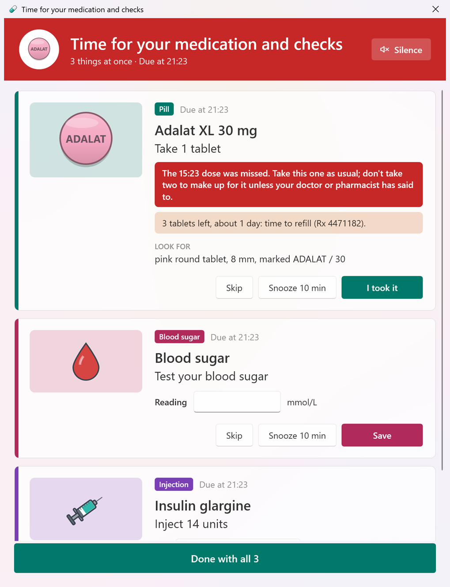
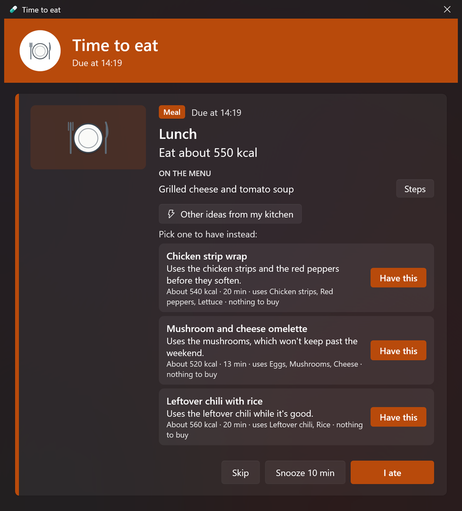

  

[health-reminder](../README.md) › [Manual](README.md) › The reminder

# The reminder

The window that comes up when something is due: in the middle of the screen, in front of everything, with a sound,
until each thing on it is answered. Everything due at the same time comes up in one window.

## The band at the top

In the colour of what's due: teal for medication, purple for an injection, rose for a blood sugar test, blue for the
other checks and for water, orange for a meal; with several kinds, the colour of the most important group
(medication, then checks, then meals and drinks).

| | |
|---|---|
| **The heading** | what it's for: **Time to take your medication**, **Time for your injection**, **Time to change your IV bag**, **Time for your inhaler**, **Time to test your blood sugar**, **Time to take your blood pressure**, **Time to weigh yourself**, **Time to eat**, **Time for a drink**, **Time for your checks**, **Time for your medication and checks**, **Time to eat and drink**, or **It's time** |
| Under it | **3 things at once · Due at 21:30** |
| **Silence** | while the sound plays: stops it, and keeps the window open |

## Each thing that's due

A card with a band of its own kind's colour:

| | |
|---|---|
| **The picture** | the pill drawn as it looks, as many times as are taken, and the photo of it under it if there is one; an icon for the other kinds |
| **The kind** and **Due at 21:30** | **yesterday** is added for a dose from the day before |
| **The name** and **what to do** | **Adalat XL 30 mg**, **Take 1 tablet**; **Inject 14 units**; **Drink 250 mL of water**; **Eat about 450 kcal** |
| **The dose before was missed** | in red, for a medication whose last dose was neither taken nor skipped: **The 08:00 dose was missed. Take this one as usual; don't take two to make up for it unless your doctor or pharmacist has said to.** For an IV drip: **The bag change due at … wasn't marked done.** |
| **Time to refill** | when it's counted and a week or less is left: **3 tablets left, about 1 day: time to refill (Rx 4471182).** |
| **LOOK FOR** | for a pill: **pink round tablet, 8 mm, marked ADALAT / 30** |
| **THE LINE AND THE BAG** | for an IV drip: **PICC line, left arm, in since Nov 14 · this bag runs out at 14:30** |
| **FOR EXAMPLE** or **ON THE MENU** | for a meal: the day's everyday idea in plain amounts, or the recipe the [Menu](menu.md) has for it, with **Steps**, which opens [its steps](cooking.md) |
| **Other ideas from my kitchen** | for a meal on the menu, with Help from Claude on (see below) |
| **Site** | for an injection: the next site in its rotation, which you can change; the one chosen is kept |
| **Reading** | for a check: type the reading (**e.g. 6.1**, **e.g. 120/80**) in its unit |
| **How much so far** | for a drink: a bar of what's been drunk today against all the day's drinks, and the same in words: **… of … so far today** |
| **Notes** | the reminder's notes |

### Its buttons

| | |
|---|---|
| **Something else…** | for a meal: had something else, like fast food. Opens [Log food](log-food.md) for it; logged **In place of** this meal, the meal counts as eaten, and its recipe doesn't come off the kitchen. The sound stops |
| **Skip** | not taking it this time: kept as skipped, not missed |
| **Snooze 10 min** | it comes back then. How long is set in [Settings](settings.md) (5 minutes to an hour) |
| **I took it** | and **Injected**, **Bag changed**, **Save** (a check, with its reading), **I ate**, **I drank it** or **Done**: it's done, at this time. When the reminder records a video, the button says **Record taking it** (or **Record and save**, **Record eating**, **Record drinking**, **Record it**), and opens [Record taking it](record.md) first |

With more than one thing on it, a wide button at the foot answers them all: **Done with all 3**, or **Record and finish
all 3** when any of them records a video (then one video covers them all).

Closing the window with its **✕** snoozes what's left on it, so it comes back.

## How hard it insists

As set under **When something is due** in [Settings](settings.md):

| | |
|---|---|
| **Gentle** | it comes up once, and stays where it is |
| **Persistent** | every 30 seconds it comes back to the middle of the screen, in front of everything, and flashes in the taskbar |
| **Insistent** | every 10 seconds, shaking, its band flashing red, with every screen behind it darkened; it can't be minimized. Only answering, snoozing or skipping puts it away |

After a missed dose of a medication, it insists a step harder than set (gentle becomes persistent, persistent becomes
insistent), and starts louder.

The sound is the group's own (medication, checks, meals and drinks), at the volume set, and repeats until it's answered
or sounds once, as Settings says. With **Get louder** on, each time it comes back unanswered it's 15% louder, up to full
volume.

## When a dose is missed

A dose that isn't answered keeps ringing until it's 12 hours old or the next dose of the same reminder is due,
whichever is first; it then counts as missed, and the reminder stops asking for it. A late reminder never asks for two doses of the
same reminder at once: an earlier one still on the window is replaced by the new one.

## Other ideas from my kitchen

With **Help from Claude** on in [Settings](settings.md), a meal that's on the menu has **Other ideas from my kitchen**.
It stops the sound and asks Claude for three other meals made from what's in [your kitchen](kitchen.md): **Asking
Claude for ideas from your kitchen…**, then **Pick one to have instead:**. Each idea has what it is, why, about how many
kcal and how long, what it uses and what you'd need. **Have this** makes it the meal: the window and the menu show it,
**Steps** opens its steps, and eating it takes what it uses off the kitchen. With nothing in the kitchen it says so,
and what was sent is on [Your data](your-data.md).

← [Add a reminder](reminder-editor.md) · [Contents](README.md) · [Record taking it](record.md) →

<!-- strongthium-links -->

---

<b>Strongthium open-source tools:</b> <a href="https://github.com/strongthium/emudhra-security-patch">eMudhra Security Patch</a> · <a href="https://github.com/strongthium/folder-size">Folder Size</a> · <b>Health Reminder</b> · <a href="https://github.com/strongthium/host-dossier">Host Dossier</a> · <a href="https://github.com/strongthium/outbound-watch">Outbound Watch</a> · <a href="https://github.com/strongthium/raw-convert">RAW Convert</a> · <a href="https://github.com/strongthium/video-dispatch">Video Dispatch</a> · <a href="https://github.com/strongthium/webdav-server">WebDAV Server</a> 
<b>More from Strongthium:</b> <a href="https://strongthium.com/linux-server-firewall">Guard</a> · <a href="https://strongthium.com/self-hosted-mail-server">Mail</a> · <a href="https://strongthium.com/self-hosted-live-chat">Chat</a> · <a href="https://strongthium.com/windows-ssh-client">Remote</a> · <a href="https://strongthium.com/twilio-sms-desktop-app">SMS</a> · <a href="https://strongthium.com/time-tracking-invoicing-software">Work</a> · <a href="https://strongthium.com/windows-registry-editor">Registry</a> · <a href="https://strongthium.com/cfml-server">DotCF</a> · <a href="https://strongthium.com/video-conferencing-dial-up-modem">Convey</a> 
<a href="https://strongthium.com">Strongthium Labs</a> · Take back control of your internet.

