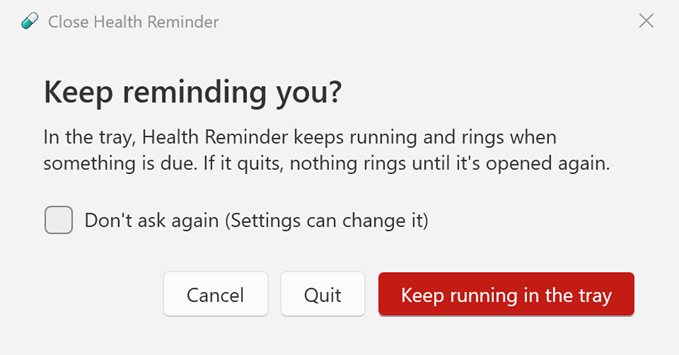

  

[health-reminder](../README.md) › [Manual](README.md) › Close Health Reminder

# Close Health Reminder

Asked when the main window's **✕** is clicked, until you tell it not to ask again. Reminders ring only while
`health-reminder` runs, so closing the window doesn't have to stop them.

**Keep reminding you?** In the tray, Health Reminder keeps running and rings when something is due. If it quits,
nothing rings until it's opened again.

| | |
|---|---|
| **Don't ask again (Settings can change it)** | remembers the answer: **Closing the window** in [Settings](settings.md) changes it |
| **Cancel** | leaves the window open |
| **Quit** | stops the program |
| **Keep running in the tray** | hides the window; the reminders keep running. **Enter** takes it |

Opened again from the tray icon, or by starting the program again, the window comes back as it was. **Quit (no more
reminders)** in the tray icon's menu stops it too. Signing out of Windows closes it without asking.

← [Stop tracking](stop-tracking.md) · [Contents](README.md) · [About](about.md) →

<!-- strongthium-links -->

---

<b>Strongthium open-source tools:</b> <a href="https://github.com/strongthium/emudhra-security-patch">eMudhra Security Patch</a> · <a href="https://github.com/strongthium/folder-size">Folder Size</a> · <b>Health Reminder</b> · <a href="https://github.com/strongthium/host-dossier">Host Dossier</a> · <a href="https://github.com/strongthium/outbound-watch">Outbound Watch</a> · <a href="https://github.com/strongthium/raw-convert">RAW Convert</a> · <a href="https://github.com/strongthium/video-dispatch">Video Dispatch</a> · <a href="https://github.com/strongthium/webdav-server">WebDAV Server</a> 
<b>More from Strongthium:</b> <a href="https://strongthium.com/linux-server-firewall">Guard</a> · <a href="https://strongthium.com/self-hosted-mail-server">Mail</a> · <a href="https://strongthium.com/self-hosted-live-chat">Chat</a> · <a href="https://strongthium.com/windows-ssh-client">Remote</a> · <a href="https://strongthium.com/twilio-sms-desktop-app">SMS</a> · <a href="https://strongthium.com/time-tracking-invoicing-software">Work</a> · <a href="https://strongthium.com/windows-registry-editor">Registry</a> · <a href="https://strongthium.com/cfml-server">DotCF</a> · <a href="https://strongthium.com/video-conferencing-dial-up-modem">Convey</a> 
<a href="https://strongthium.com">Strongthium Labs</a> · Take back control of your internet.

