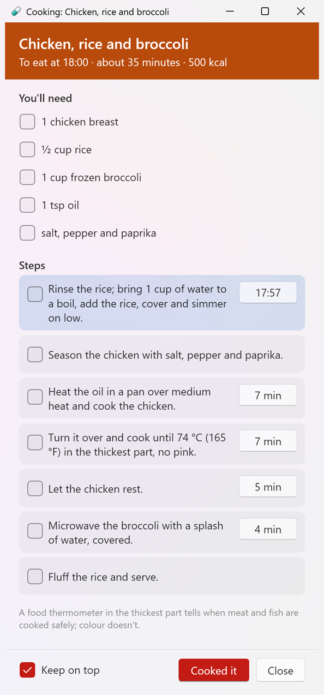

  

[health-reminder](../README.md) › [Manual](README.md) › Cooking

# Cooking

A recipe's steps, at the right side of the screen while you cook: what it needs, to tick off, and each step, with a
timer for those that take time. The same window shows an exercise session's steps (see [Exercise](exercise.md)).

It opens from **Steps** (on [Today](today.md), the [Menu](menu.md), a meal's [reminder](alarm.md) or a
[kitchen alert](kitchen-alerts.md)), from **Show the steps**, and by itself when it's time to start, if the Menu page
says so.

## The window

| | |
|---|---|
| **The heading** | the recipe, and **To eat at 20:00 · about 35 minutes · 580 kcal**. For a session: what it is, how long, and about how many kcal |
| **You'll need** | the ingredients, or what a session needs, each with a box to tick |
| **Steps** | each step with a box to tick when it's done. A step that takes time has a timer button: **12 min** starts it, it counts down (**11:42**), and **Time's up** when it ends, when it chimes and brings the window forward. Clicking a running timer stops it |
| Under the steps | **A food thermometer in the thickest part tells when meat and fish are cooked safely; colour doesn't.** For a session, what to watch for (see [Exercise](exercise.md)) |
| **Keep on top** | keeps the window in front of other windows; ticked to begin with when **Keep the steps in front of other windows** is ticked on the Menu page |
| **Cooked it** | the meal is made: what the recipe used comes off [your kitchen](kitchen.md), once for the meal (eating it afterwards doesn't take it off again). For a session the button is **Done**, which logs the session |
| **Close** | closes it, without taking anything off |

Opening another recipe or session's steps shows them in the same window.

← [In the kitchen](kitchen-alerts.md) · [Contents](README.md) · [Groceries](groceries.md) →

<!-- strongthium-links -->

---

<b>Strongthium open-source tools:</b> <a href="https://github.com/strongthium/emudhra-security-patch">eMudhra Security Patch</a> · <a href="https://github.com/strongthium/folder-size">Folder Size</a> · <b>Health Reminder</b> · <a href="https://github.com/strongthium/host-dossier">Host Dossier</a> · <a href="https://github.com/strongthium/outbound-watch">Outbound Watch</a> · <a href="https://github.com/strongthium/raw-convert">RAW Convert</a> · <a href="https://github.com/strongthium/video-dispatch">Video Dispatch</a> · <a href="https://github.com/strongthium/webdav-server">WebDAV Server</a> 
<b>More from Strongthium:</b> <a href="https://strongthium.com/linux-server-firewall">Guard</a> · <a href="https://strongthium.com/self-hosted-mail-server">Mail</a> · <a href="https://strongthium.com/self-hosted-live-chat">Chat</a> · <a href="https://strongthium.com/windows-ssh-client">Remote</a> · <a href="https://strongthium.com/twilio-sms-desktop-app">SMS</a> · <a href="https://strongthium.com/time-tracking-invoicing-software">Work</a> · <a href="https://strongthium.com/windows-registry-editor">Registry</a> · <a href="https://strongthium.com/cfml-server">DotCF</a> · <a href="https://strongthium.com/video-conferencing-dial-up-modem">Convey</a> 
<a href="https://strongthium.com">Strongthium Labs</a> · Take back control of your internet.

