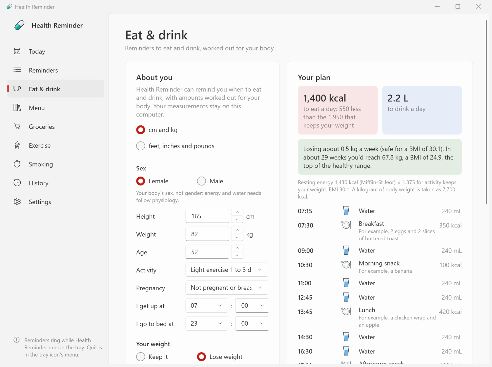
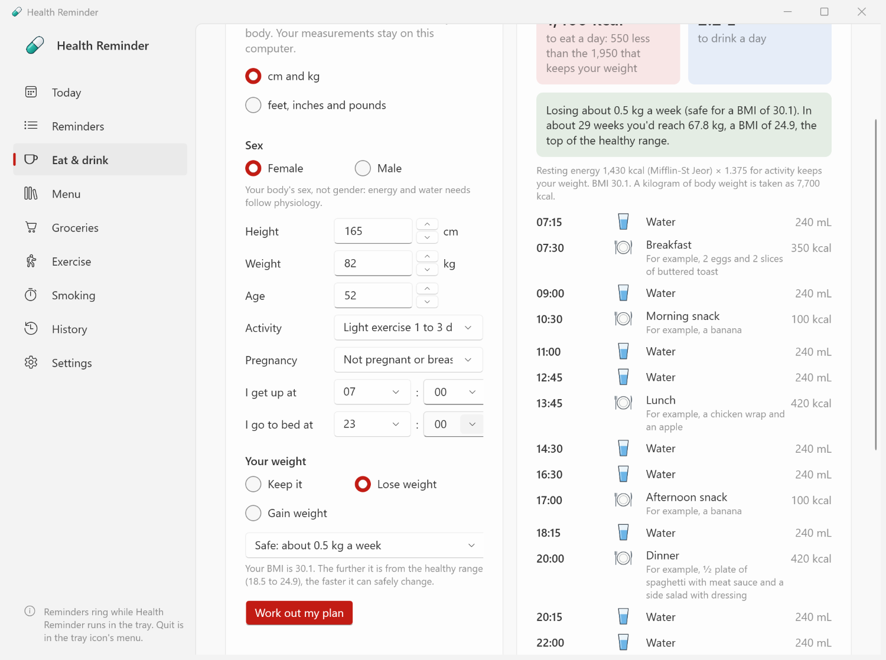

  

[health-reminder](../README.md) › [Manual](README.md) › Eat & drink

# Eat & drink

Reminders to eat and drink, worked out for your body: a day of meals and drinks from your sex, height, weight, age and
how active you are, and when you get up and go to bed. You see the plan before anything is set up.

## About you

Your measurements stay on this computer.

| | |
|---|---|
| **cm and kg** or **feet, inches and pounds** | the units the form is in; switching converts what's typed |
| **Sex** | **Female** or **Male**: your body's sex, not gender, because energy and water needs follow physiology |
| **Height**, **Weight**, **Age** | |
| **Activity** | **Mostly sitting, little exercise**, **Light exercise 1 to 3 days a week**, **Moderate exercise 3 to 5 days a week**, **Hard exercise 6 or 7 days a week**, or **Physical job, or training twice a day** |
| **Pregnancy** | for **Female**: **Not pregnant or breastfeeding**, **Pregnant (second or third trimester)**, or **Breastfeeding** |
| **I get up at**, **I go to bed at** | the day the meals and drinks are spread over (7:00 and 23:00 to begin with). [Smoking](smoking.md) uses when you get up too |
| **Your weight** | **Keep it**, **Lose weight** or **Gain weight**; and how fast: **Safe**, **Medium** or **Aggressive**, each with what it means at your BMI (**Safe: about 0.5 kg a week**). Under it: **Your BMI is 30.1. The further it is from the healthy range (18.5 to 24.9), the faster it can safely change.** When losing or gaining isn't planned for your BMI, or in pregnancy or while breastfeeding, it says why instead |
| **Work out my plan** | shows the plan on the right. If something's missing it says what: **Choose female or male.**, **Fill in your height.**, and so on |

## Your plan

| | |
|---|---|
| **The calories** | to eat a day, and how that compares with what keeps your weight: **1,950 kcal**, **to eat a day: 550 less than the 2,500 that keeps your weight** |
| **The drinks** | to drink a day, in the unit set in [Settings](settings.md) |
| **The goal** | when losing or gaining: how fast, and about how many weeks to the edge of the healthy range: **Losing about 0.5 kg a week (safe for a BMI of 30.1). In about 34 weeks you'd reach 78.9 kg, a BMI of 24.9, the top of the healthy range.** |
| **How it's worked out** | **Resting energy 1,812 kcal (Mifflin-St Jeor) × 1.375 for activity keeps your weight. BMI 30.1. A kilogram of body weight is taken as 7,700 kcal.** |
| **The day** | each meal, snack and drink at its time, with its amount. Each meal has an everyday idea near its calories, in household amounts: **For example, 2 eggs, 2 slices of buttered toast and a glass of orange juice** |
| **Other meal ideas** | other ideas for the same meals |
| **Add them to my grocery list** | puts what the ideas need on the [grocery list](groceries.md), leaving out what's on it already, and says what was added |
| **The notes** | what to keep in mind: a doctor's limit on fluids comes first; weigh yourself once a week and work the plan out again every few weeks; losing or gaining can change the doses some medication needs (for diabetes or blood pressure), so tell your doctor; with diabetes, eat to your care team's plan |
| **Use this plan** | turns it into reminders: the meals, snacks and drinks, on [Today](today.md) and [Reminders](reminders.md), marked **Eating plan**. Using a plan again replaces them: **Using it replaces the eating plan you have now.** |
| **Stop the eating and drinking reminders** | deletes the reminders the plan made |

## How it's worked out

| | |
|---|---|
| Energy | the Mifflin-St Jeor equation for resting energy (10 × kg + 6.25 × cm − 5 × age, + 5 for men, − 161 for women), times 1.2 (mostly sitting) to 1.9 (physical job or training twice a day); + 350 kcal pregnant, + 400 breastfeeding |
| Drinks | 80% of the day's total water, the rest coming from food: the U.S. National Academies' adequate intake (3.7 L for men, 2.7 L for women, 3.0 L pregnant, 3.8 L breastfeeding), or 30 mL a kilogram if that's more; + 250 to 750 mL for exercise, at most 4.5 L |
| Times | breakfast half an hour after getting up, dinner 3 hours before bed, lunch between them, a snack in any gap of 4½ hours or more; energy split 25 / 30 / 30 and 7.5 a snack. Drinks of about a glass, evenly from getting up to an hour before bed |
| Losing or gaining | a kilogram of body weight taken as 7,700 kcal; the pace follows the BMI; a plan to lose never goes under 1,200 kcal a day for a woman or 1,500 for a man |

| BMI | Lose: safe / medium / aggressive | Gain: safe / medium / aggressive |
|---|---|---|
| under 18.5 | not planned | 0.25 / 0.5 / 0.75 kg a week |
| 18.5 to 20 | not planned | 0.15 / 0.25 / 0.35 kg a week |
| 20 to 25 | 0.25 / 0.35 / 0.5 kg a week | 0.15 / 0.25 / 0.35 kg a week |
| 25 to 30 | 0.25 / 0.5 / 0.75 kg a week | not planned |
| 30 and over | 0.5 / 0.75 / 1 kg a week | not planned |

The formulas are for adults. They're a starting point, not dietary advice: if a doctor has told you to limit fluids
or gave you a meal plan for diabetes, follow that instead.

← [History](history.md) · [Contents](README.md) · [Menu](menu.md) →

<!-- strongthium-links -->

---

<b>Strongthium open-source tools:</b> <a href="https://github.com/strongthium/emudhra-security-patch">eMudhra Security Patch</a> · <a href="https://github.com/strongthium/folder-size">Folder Size</a> · <b>Health Reminder</b> · <a href="https://github.com/strongthium/host-dossier">Host Dossier</a> · <a href="https://github.com/strongthium/outbound-watch">Outbound Watch</a> · <a href="https://github.com/strongthium/raw-convert">RAW Convert</a> · <a href="https://github.com/strongthium/video-dispatch">Video Dispatch</a> · <a href="https://github.com/strongthium/webdav-server">WebDAV Server</a> 
<b>More from Strongthium:</b> <a href="https://strongthium.com/linux-server-firewall">Guard</a> · <a href="https://strongthium.com/self-hosted-mail-server">Mail</a> · <a href="https://strongthium.com/self-hosted-live-chat">Chat</a> · <a href="https://strongthium.com/windows-ssh-client">Remote</a> · <a href="https://strongthium.com/twilio-sms-desktop-app">SMS</a> · <a href="https://strongthium.com/time-tracking-invoicing-software">Work</a> · <a href="https://strongthium.com/windows-registry-editor">Registry</a> · <a href="https://strongthium.com/cfml-server">DotCF</a> · <a href="https://strongthium.com/video-conferencing-dial-up-modem">Convey</a> 
<a href="https://strongthium.com">Strongthium Labs</a> · Take back control of your internet.

