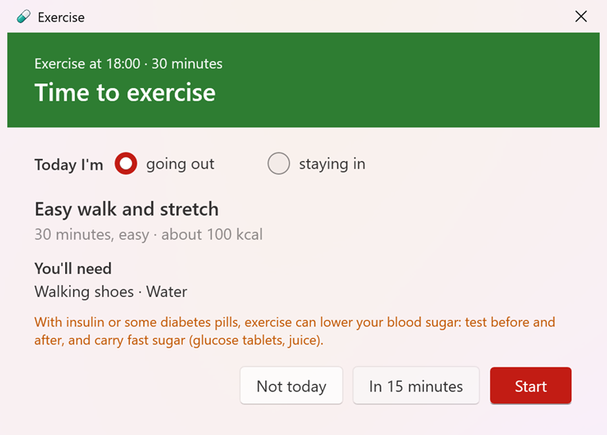
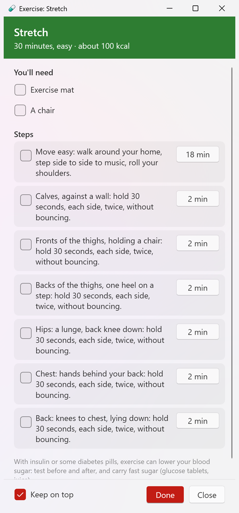

  

[health-reminder](../README.md) › [Manual](README.md) › Time to exercise

# Time to exercise

With **Alerts: 15 minutes before, with what's needed, and at the time** ticked on the [Exercise](exercise.md) page,
two alerts come up on a day set aside: a quarter of an hour ahead, so shoes and water are ready, and at the time. Each
comes up in the middle of the screen, in front of other windows, and rings once with the meals sound (silently, when
[the reminder](alarm.md) is already up).

| | |
|---|---|
| **The band** | **Exercise at 18:00 · 30 minutes**, and **Exercise in 15 minutes: get ready** or **Time to exercise** |
| **Today I'm going out** / **staying in** | when the plan says **Ask me each time**: which session to show |
| **The session** | its name, how long and about how many kcal |
| **You'll need** | what to have ready: walking shoes, water, a mat… |
| The insulin note | when there are insulin or blood sugar reminders: test before and after, and carry fast sugar |

| | |
|---|---|
| **Not today** | skips the session: neither alert comes back today |
| **In 15 minutes** | at the time: it comes back then |
| **Ready** | ahead of time: closes it |
| **Start** | at the time: opens the session's steps at the side of the screen, each with its timer ([Cooking](cooking.md)); **Done** there logs it |

The session is on [Today](today.md) too, with **Start**. The alerts don't ring while tracking is stopped.

The steps of a session, with what it needs, the timers, and **Done**.

← [Exercise](exercise.md) · [Contents](README.md) · [Smoking](smoking.md) →

<!-- strongthium-links -->

---

<b>Strongthium open-source tools:</b> <a href="https://github.com/strongthium/emudhra-security-patch">eMudhra Security Patch</a> · <a href="https://github.com/strongthium/folder-size">Folder Size</a> · <b>Health Reminder</b> · <a href="https://github.com/strongthium/host-dossier">Host Dossier</a> · <a href="https://github.com/strongthium/outbound-watch">Outbound Watch</a> · <a href="https://github.com/strongthium/raw-convert">RAW Convert</a> · <a href="https://github.com/strongthium/video-dispatch">Video Dispatch</a> · <a href="https://github.com/strongthium/webdav-server">WebDAV Server</a> 
<b>More from Strongthium:</b> <a href="https://strongthium.com/linux-server-firewall">Guard</a> · <a href="https://strongthium.com/self-hosted-mail-server">Mail</a> · <a href="https://strongthium.com/self-hosted-live-chat">Chat</a> · <a href="https://strongthium.com/windows-ssh-client">Remote</a> · <a href="https://strongthium.com/twilio-sms-desktop-app">SMS</a> · <a href="https://strongthium.com/time-tracking-invoicing-software">Work</a> · <a href="https://strongthium.com/windows-registry-editor">Registry</a> · <a href="https://strongthium.com/cfml-server">DotCF</a> · <a href="https://strongthium.com/video-conferencing-dial-up-modem">Convey</a> 
<a href="https://strongthium.com">Strongthium Labs</a> · Take back control of your internet.

