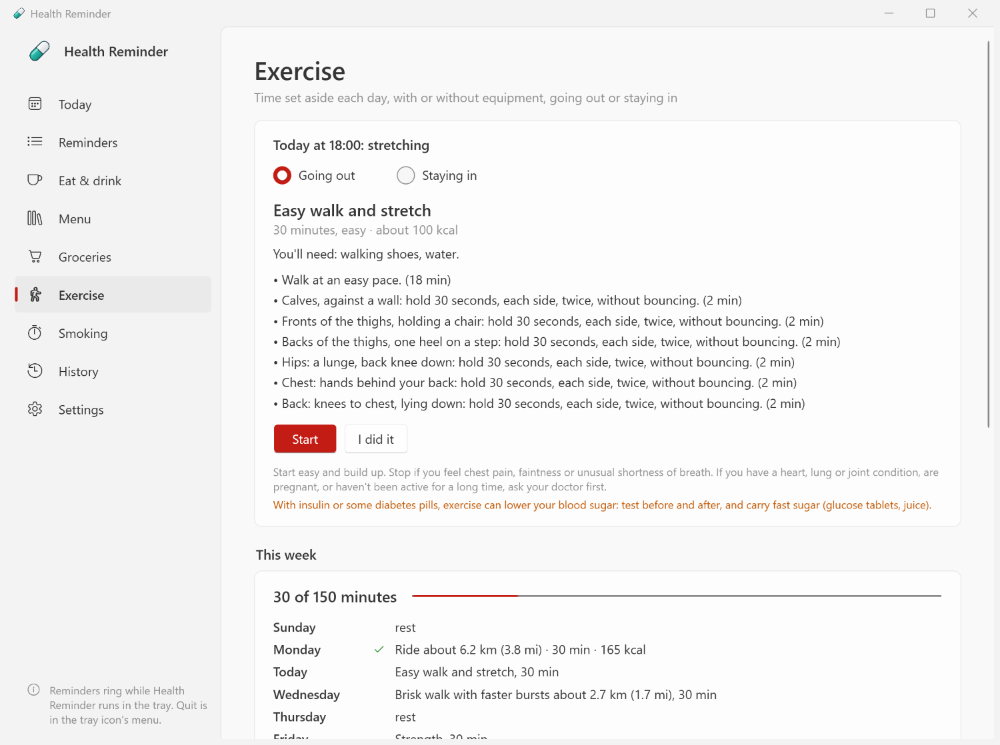
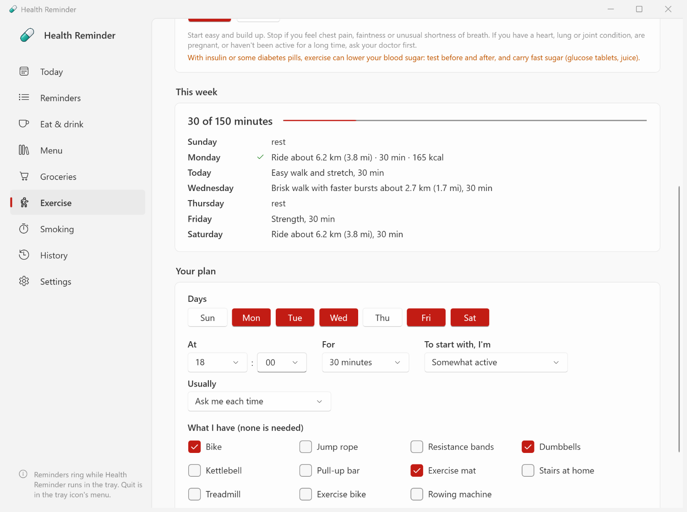

  

[health-reminder](../README.md) › [Manual](README.md) › Exercise

# Exercise

Time set aside on the days you choose, at a time and for 15 to 60 minutes, with or without equipment, going out or
staying in. Each session is planned from what you have and where you're starting from, and gets harder as you go.

## Today

| | |
|---|---|
| **The heading** | **Today at 18:00: cardio** (or **strength**, or **stretching**); on a day off, **A day off. Next: Friday at 18:00, strength.**; with no plan yet, **Set up your plan below: the days and time, how long, and what you have. None is needed.** |
| **Going out** or **Staying in** | which session to show: going out is a walk, brisk walk, walk-jog or jog with its distance (**walk about 2.3 km (1.4 mi)**), or every other time a ride if there's a bike; staying in is moves in a room in timed rounds, or the treadmill, exercise bike or rower |
| **The session** | its name, how long and about how many kcal, **You'll need:** (shoes, water, a mat, the dumbbells…), and its steps, with the minutes each takes |
| **Start** | opens the steps at the side of the screen, each with its timer ([Cooking](cooking.md)); **Done** there logs it |
| **I did it** | logs it without the steps: **Done at 18:36** |

Under it, what to keep in mind: **Start easy and build up. Stop if you feel chest pain, faintness or unusual shortness
of breath. If you have a heart, lung or joint condition, are pregnant, or haven't been active for a long time, ask
your doctor first.** When there are insulin or blood sugar reminders it adds: **With insulin or some diabetes pills,
exercise can lower your blood sugar: test before and after, and carry fast sugar (glucose tablets, juice).**

## This week

**95 of 150 minutes**, with a bar: the week against the WHO's 150 minutes. Under it each day of the week, from its
first day: a session done, with a tick, how long and the calories it used; a session to come, or **· not done** for
one that's gone by; or **rest**. The calories are the session's METs (from the Compendium of Physical Activities) times
your weight from [Eat & drink](eat-drink.md).

## Your plan

| | |
|---|---|
| **Days** | a button for each day of the week; Monday, Wednesday and Friday to begin with |
| **At** | the time; 18:00 to begin with |
| **For** | **15 minutes**, **20 minutes**, **30 minutes**, **45 minutes** or **60 minutes** |
| **To start with, I'm** | **Just starting out**, **Somewhat active** or **Fit** |
| **Usually** | **Ask me each time**, **Going out** or **Staying in** |
| **What I have (none is needed)** | **Bike**, **Jump rope**, **Resistance bands**, **Dumbbells**, **Kettlebell**, **Pull-up bar**, **Exercise mat**, **Stairs at home**, **Treadmill**, **Exercise bike**, **Rowing machine** |
| **Alerts: 15 minutes before, with what's needed, and at the time** | see [Time to exercise](exercise-alert.md) |
| **Start this plan** / **Save the plan** | keeps it: **Saved.** Changing the level starts the climb again from it. Without a day: **Pick at least one day.** |
| **Start over from the beginning** | sessions get harder every three weeks from the start; this starts again at the level chosen |

## How it plans

- Cardio, strength and stretching in turn (cardio and strength, two days a week or fewer).
- From where you are, then forward: it starts at the level you say and steps up every three weeks: walk, brisk walk,
  bursts, walk-jog, jog; sit-to-stands to squats; wall push-ups, then knee push-ups, then full ones; more rounds.
- Equipment swaps in: goblet squats and rows with dumbbells, band rows, kettlebell swings, hangs then chin-ups on a
  bar.

Exercise is on [Today](today.md) too, and doesn't ring while tracking is stopped.

← [Log food](log-food.md) · [Contents](README.md) · [Time to exercise](exercise-alert.md) →

<!-- strongthium-links -->

---

<b>Strongthium open-source tools:</b> <a href="https://github.com/strongthium/emudhra-security-patch">eMudhra Security Patch</a> · <a href="https://github.com/strongthium/folder-size">Folder Size</a> · <b>Health Reminder</b> · <a href="https://github.com/strongthium/host-dossier">Host Dossier</a> · <a href="https://github.com/strongthium/outbound-watch">Outbound Watch</a> · <a href="https://github.com/strongthium/raw-convert">RAW Convert</a> · <a href="https://github.com/strongthium/video-dispatch">Video Dispatch</a> · <a href="https://github.com/strongthium/webdav-server">WebDAV Server</a> 
<b>More from Strongthium:</b> <a href="https://strongthium.com/linux-server-firewall">Guard</a> · <a href="https://strongthium.com/self-hosted-mail-server">Mail</a> · <a href="https://strongthium.com/self-hosted-live-chat">Chat</a> · <a href="https://strongthium.com/windows-ssh-client">Remote</a> · <a href="https://strongthium.com/twilio-sms-desktop-app">SMS</a> · <a href="https://strongthium.com/time-tracking-invoicing-software">Work</a> · <a href="https://strongthium.com/windows-registry-editor">Registry</a> · <a href="https://strongthium.com/cfml-server">DotCF</a> · <a href="https://strongthium.com/video-conferencing-dial-up-modem">Convey</a> 
<a href="https://strongthium.com">Strongthium Labs</a> · Take back control of your internet.

