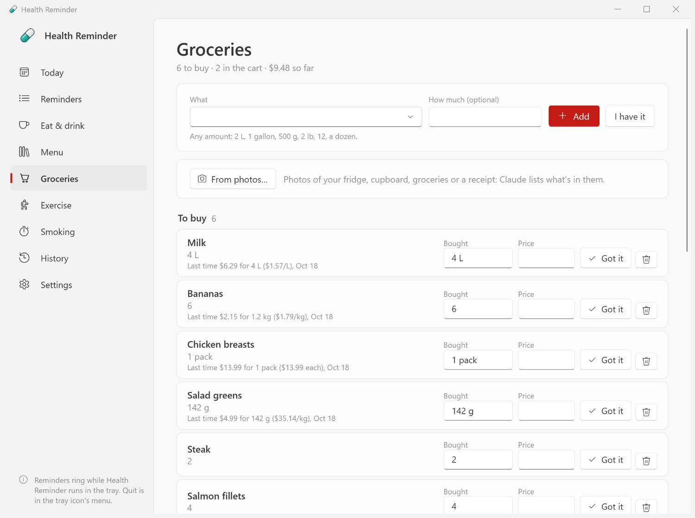
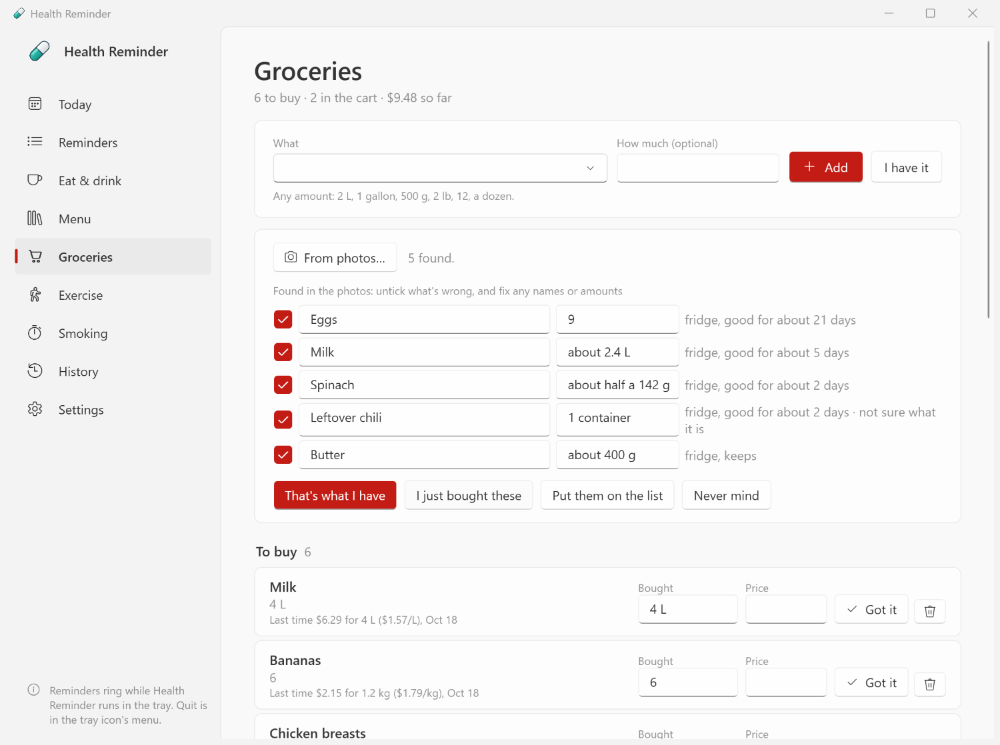

  

[health-reminder](../README.md) › [Manual](README.md) › Groceries

# Groceries

The shopping list, and what things cost as they're bought; what's been bought before, to buy again; and, further down
the same page, [your kitchen](kitchen.md).

Under the title: **4 to buy · 2 in the cart · $11.48 so far**, or **What to buy, and what it cost** when the list is
empty.

## Search

**Search groceries and kitchen** shows only what matches, on the list, in the cart, bought before and in the kitchen,
every place opened: a name or a brand ("pep" finds Pepsi and red peppers, "diet pep" just Diet Pepsi), or the start of
the kind of food it is ("pasta" finds the spaghetti and the rotini, "meat" what's in meat and fish). The counts say how
many of how many match. **Esc** or the **✕** shows everything again. When nothing matches: **Nothing on the list,
bought before or in the kitchen matches "…". To add it, type it under What.**

## Adding to the list

| | |
|---|---|
| **What** | the name, or a whole line the way the package says it: `Bick's Gourmet Tangy Dill Relish 370 ml` reads as Gourmet Tangy Dill Relish, by Bick's, 370 mL. The line under the boxes shows how it's read as you type: **Reads as: …**. Names you've had before are offered as you type |
| **How much (optional)** | any amount: `2 L`, `1 gallon`, `500g`, `1½ cups`, `2 x 355 mL`, `2 lb`, `12`, `a dozen`. The line under says how it's read: **That's 1.89 L (liquid).**, or **Kept as typed: it isn't an amount the list can compare.** |
| **Add** | puts it on the list (**Enter** does too) |
| **I have it** | puts it straight into your kitchen instead of on the list: **Added Rice to Pantry.** Something new to the kitchen asks where it goes first ([Put it away](put-away.md)) |

An amount with a unit is taken from either end of the line, and a brand from either end once it's been seen. What could
be read another way (a bare number, as in `Area 51`, or a first word like `Shepherd's`) is asked about first, in
[Is this right?](is-this-right.md); a name you've had before stays whole, so `7 Up` stays `7 Up` once it's known.

Every liquid is shown in one unit and every weight in another: metric (mL and L, g and kg) or U.S. (fl oz and gal, oz
and lb), as **Groceries** in [Settings](settings.md) says.

## From photos…

With **Help from Claude** on in [Settings](settings.md), **From photos…** takes photos (up to 10 at a time, `.jpg`,
`.png`, `.webp` or `.heic`) of the fridge, the freezer, a cupboard, groceries on the counter or a receipt, and Claude
lists what's in them: **Found in the photos: untick what's wrong, and fix any names or amounts**. Each line has a box,
the name and the amount to fix, where it's kept and about how many days it's good for, and **not sure what it is** when
Claude wasn't.

| | |
|---|---|
| **That's what I have** | a photo of where they're kept: these are the amounts there are now. Read from a photo, they're marked to be counted |
| **I just bought these** | a receipt or a haul: added to what's in the kitchen |
| **Put them on the list** | on the shopping list |
| **Never mind** | none of them |

The photos are made smaller first. Without Help from Claude the button is greyed and it says **To add groceries from
photos, turn on Help from Claude in Settings.** What's sent to Anthropic is on [Your data](your-data.md).

## To buy

**To buy**, with how many, and **Print**, which prints the list to take to the store ([Print](print.md)).

Each line has its name and brand, the amount in the units everything is shown in, and what it cost the last time:
**Last time $5.79 for 4 L ($1.45/L), Nov 3**.

| | |
|---|---|
| **Bought** | how much was bought, in any unit; the amount listed to begin with |
| **Price** | what it cost (optional), the way you write money: `3.49`, `$3.49`. Otherwise: **That isn't a price: type what it cost, like 3.49.** |
| **Got it** | it's bought: into the cart and into your kitchen. Something new to the kitchen asks where it goes first ([Put it away](put-away.md)); cancelled, it stays on the list |
| **The bin** | takes it off the list |

With nothing on the list, the page says **The list is empty. Add what you need above, or from the meal ideas on the Eat
& drink page.**

## In the cart

**In the cart**, with how many and what they've come to so far. Each line has the amount and the time it was bought,
the price and the price per litre or kilogram (or gallon or pound, or each). The undo button at its end puts it back
on the list.

**Done shopping** clears what's bought off the list; its prices are kept, to show next time the same thing is on it.

## Bought before

Everything that's been in the kitchen, by name and brand, kept after it's used up: how much came the last time and what
it cost, how many times it's been bought, and how much of it there is now (**none left** stands out, or **on the
list**).

| | |
|---|---|
| **Just what's run out** / **Show all** | what's run out first; the rest with **Show all** |
| **Add to list** | puts the same one back on the list, its brand and as much as last time. Bought, it's put away the way it was kept, with its picture and what one weighs |
| **✕** | takes it out of this list, until it's bought again |

Renamed in the kitchen, a thing keeps its history under the new name, and the list and the prices paid go with it.

When the list looks to have things left over (never bought, not in the kitchen, never logged as eaten, most likely an
old name from before something was renamed) or a name spelled two ways, it offers to tidy it: **Have a look** shows
them, ticked, with **What's ticked comes out of this list. Untick anything you really did have.**, and **Tidy it** takes
out what's still ticked and spells the names the way they are now. **Not now** leaves it; it's offered again only when
there's more. Nothing in your kitchen changes.

## Your kitchen

Below all this is [your kitchen](kitchen.md): what's in the fridge, the freezer and the cupboards.

← [Cooking](cooking.md) · [Contents](README.md) · [Is this right?](is-this-right.md) →

<!-- strongthium-links -->

---

<b>Strongthium open-source tools:</b> <a href="https://github.com/strongthium/emudhra-security-patch">eMudhra Security Patch</a> · <a href="https://github.com/strongthium/folder-size">Folder Size</a> · <b>Health Reminder</b> · <a href="https://github.com/strongthium/host-dossier">Host Dossier</a> · <a href="https://github.com/strongthium/outbound-watch">Outbound Watch</a> · <a href="https://github.com/strongthium/raw-convert">RAW Convert</a> · <a href="https://github.com/strongthium/video-dispatch">Video Dispatch</a> · <a href="https://github.com/strongthium/webdav-server">WebDAV Server</a> 
<b>More from Strongthium:</b> <a href="https://strongthium.com/linux-server-firewall">Guard</a> · <a href="https://strongthium.com/self-hosted-mail-server">Mail</a> · <a href="https://strongthium.com/self-hosted-live-chat">Chat</a> · <a href="https://strongthium.com/windows-ssh-client">Remote</a> · <a href="https://strongthium.com/twilio-sms-desktop-app">SMS</a> · <a href="https://strongthium.com/time-tracking-invoicing-software">Work</a> · <a href="https://strongthium.com/windows-registry-editor">Registry</a> · <a href="https://strongthium.com/cfml-server">DotCF</a> · <a href="https://strongthium.com/video-conferencing-dial-up-modem">Convey</a> 
<a href="https://strongthium.com">Strongthium Labs</a> · Take back control of your internet.

