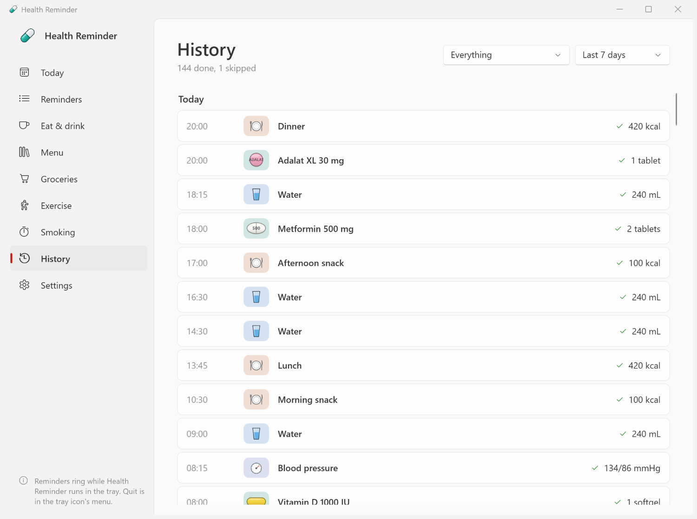

  

[health-reminder](../README.md) › [Manual](README.md) › History

# History

What was done, skipped and read, day by day, newest first: every dose marked taken or skipped, with the readings, the
amounts, the injection sites and the videos.

## At the top

| | |
|---|---|
| Under the title | **42 done, 3 skipped** over the days shown |
| The first list | what's shown: **Everything**, **Medication**, **Checks and readings**, or **Meals and drinks** |
| The second list | how far back: **Last 7 days**, **Last 30 days**, **Last 90 days** or **Last year** |

## A line

Under each day's heading (**Today**, **Yesterday**, then the date):

| | |
|---|---|
| **The time** | when it was due |
| **The picture** and **name** | |
| **✓** or **✕** | taken, or skipped |
| **What came of it** | **Skipped**; or the reading (**6.4 mmol/L**, **128/82 mmHg**), the amount (**2 tablets**, **14 units**, **250 mL**) or **Done**; then the injection site or the IV line it went in by; and **at 09:12** when it was answered half an hour or more from its time |
| **Watch** | for a dose recorded on video: checks the video and plays it |

Only what was answered is here. What was missed isn't: [Stats](stats.md) counts it, and prints it by name and time.

## Watching a video

**Watch** works out the video's SHA-256 again and compares it with the one kept when it was recorded, says what it
found above the list, then plays the video in Windows' own player:

| | |
|---|---|
| **The video of … is unchanged since it was recorded (SHA-256 …).** | it's the file that was recorded |
| **The video of … has been changed since it was recorded: its SHA-256 is …, it was ….** | the file isn't the one that was recorded |
| **The video of … is no longer there (…).** | the file has been moved or deleted |

With nothing in the days chosen, it says **Nothing recorded in this time.**

← [Record taking it](record.md) · [Contents](README.md) · [Eat & drink](eat-drink.md) →

<!-- strongthium-links -->

---

<b>Strongthium open-source tools:</b> <a href="https://github.com/strongthium/emudhra-security-patch">eMudhra Security Patch</a> · <a href="https://github.com/strongthium/folder-size">Folder Size</a> · <b>Health Reminder</b> · <a href="https://github.com/strongthium/host-dossier">Host Dossier</a> · <a href="https://github.com/strongthium/outbound-watch">Outbound Watch</a> · <a href="https://github.com/strongthium/raw-convert">RAW Convert</a> · <a href="https://github.com/strongthium/video-dispatch">Video Dispatch</a> · <a href="https://github.com/strongthium/webdav-server">WebDAV Server</a> 
<b>More from Strongthium:</b> <a href="https://strongthium.com/linux-server-firewall">Guard</a> · <a href="https://strongthium.com/self-hosted-mail-server">Mail</a> · <a href="https://strongthium.com/self-hosted-live-chat">Chat</a> · <a href="https://strongthium.com/windows-ssh-client">Remote</a> · <a href="https://strongthium.com/twilio-sms-desktop-app">SMS</a> · <a href="https://strongthium.com/time-tracking-invoicing-software">Work</a> · <a href="https://strongthium.com/windows-registry-editor">Registry</a> · <a href="https://strongthium.com/cfml-server">DotCF</a> · <a href="https://strongthium.com/video-conferencing-dial-up-modem">Convey</a> 
<a href="https://strongthium.com">Strongthium Labs</a> · Take back control of your internet.

