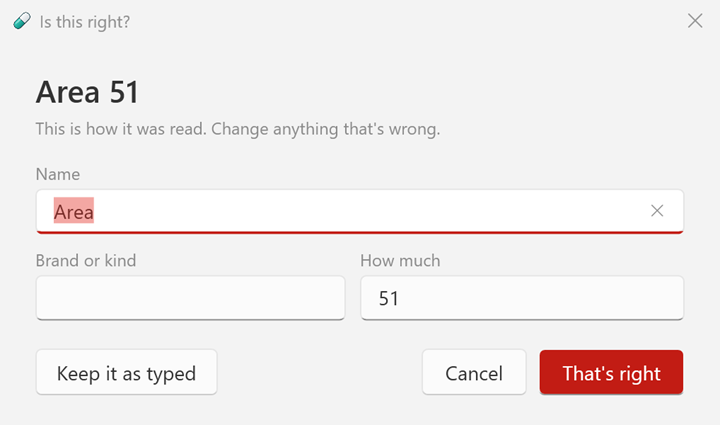

  

[health-reminder](../README.md) › [Manual](README.md) › Is this right?

# Is this right?

A line typed under **What** on [Groceries](groceries.md) that could be read more than one way: a bare number (`Area
51`), or a first word that might be a brand (`Shepherd's`). Before it's added (with **Add** or **I have it**), this asks.

| | |
|---|---|
| **The heading** | the line as it was typed |
| **Name** | what it was read as |
| **Brand or kind** | the brand read out of it, if any: which one it is (Schneiders, Chudleys, the 2% one…) |
| **How much** | the amount read out of it, if any, in any unit |
| **Keep it as typed** | all of it is the name |
| **Cancel** | adds nothing |
| **That's right** | adds it as the boxes say (**Enter** does too) |

A name there's been before isn't asked about again: it stays whole.

← [Groceries](groceries.md) · [Contents](README.md) · [Your kitchen](kitchen.md) →

<!-- strongthium-links -->

---

<b>Strongthium open-source tools:</b> <a href="https://github.com/strongthium/emudhra-security-patch">eMudhra Security Patch</a> · <a href="https://github.com/strongthium/folder-size">Folder Size</a> · <b>Health Reminder</b> · <a href="https://github.com/strongthium/host-dossier">Host Dossier</a> · <a href="https://github.com/strongthium/outbound-watch">Outbound Watch</a> · <a href="https://github.com/strongthium/raw-convert">RAW Convert</a> · <a href="https://github.com/strongthium/video-dispatch">Video Dispatch</a> · <a href="https://github.com/strongthium/webdav-server">WebDAV Server</a> 
<b>More from Strongthium:</b> <a href="https://strongthium.com/linux-server-firewall">Guard</a> · <a href="https://strongthium.com/self-hosted-mail-server">Mail</a> · <a href="https://strongthium.com/self-hosted-live-chat">Chat</a> · <a href="https://strongthium.com/windows-ssh-client">Remote</a> · <a href="https://strongthium.com/twilio-sms-desktop-app">SMS</a> · <a href="https://strongthium.com/time-tracking-invoicing-software">Work</a> · <a href="https://strongthium.com/windows-registry-editor">Registry</a> · <a href="https://strongthium.com/cfml-server">DotCF</a> · <a href="https://strongthium.com/video-conferencing-dial-up-modem">Convey</a> 
<a href="https://strongthium.com">Strongthium Labs</a> · Take back control of your internet.

