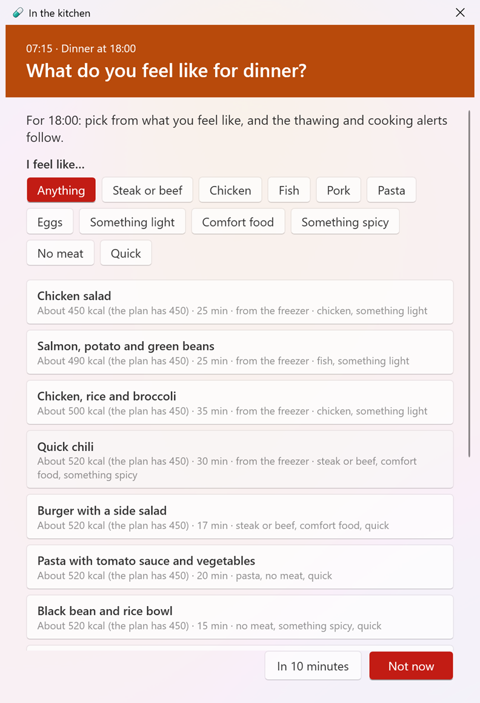
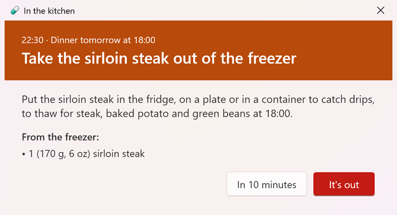

  

[health-reminder](../README.md) › [Manual](README.md) › In the kitchen

# In the kitchen

The kitchen alerts, timed back from each meal on the [Menu](menu.md): what you feel like, for a meal left to the day;
taking it out of the freezer; that it's thawed; and when to start. Each comes up in the middle of the screen, in front
of other windows, and rings once with the meals sound (silently, when [the reminder](alarm.md) is already up). They're
on [Today](today.md) too, under **In the kitchen today**. One comes up at a time.

## The window

| | |
|---|---|
| **The band** | when, and the meal it's for: **18:25 · Dinner at 20:00**, or **Breakfast tomorrow at 07:30** |
| **The heading** | what to do (below) |
| Under it | how: **Put the chicken breast in the fridge, on a plate or in a container to catch drips, to thaw for chicken, rice and broccoli at 20:00.** |
| **What it needs** | **From the freezer:** and what comes out of it; or, when it's time to start, the recipe's name and everything it needs |

## The alerts

| Heading | When | Its button |
|---|---|---|
| **What do you feel like for dinner?** | for a meal set to **Decide on the day**: that morning, a quarter of an hour after you get up; for breakfast, the evening before, an hour before bed | **Not now** |
| **Take the chicken breast out of the freezer** | in the fridge: long enough before for it to thaw, moved to before bed if it would fall in the night. In cold water: an hour before you start | **It's out** |
| **The chicken breast should be thawed** | thawing in the fridge: when it should be. **Check it's soft all the way through; keep it in the fridge until you cook it.** | **OK** |
| **Change the thawing water** | thawing in cold water: half an hour after it went in | **Changed** |
| **Time to start chicken, rice and broccoli** | when it's time to get it ready (**Thawed: time to start …** after thawing in cold water) | **Starting** |
| **Time to start cooking** | when the cooking itself should start | **Cooking** |

With more than one frozen thing it says **frozen food** instead of the name.

## Choosing what to have

**What do you feel like for dinner?** has **I feel like…**: **Anything**, **Steak or beef**, **Chicken**, **Fish**,
**Pork**, **Pasta**, **Eggs**, **Something light**, **Comfort food**, **Something spicy**, **No meat** or **Quick**, and
the recipes for that meal that fit, closest to its calories first, each with about how many kcal (and the plan's),
how long, and whether something comes from the freezer. Clicking one picks it for the meal, and the thawing and
cooking alerts follow from it. If none fits: **Nothing for this meal matches; pick another.**

## The buttons

| | |
|---|---|
| **Show the steps** | when it's time to start or cook: opens the recipe's steps at the side of the screen ([Cooking](cooking.md)) |
| **In 10 minutes** | it comes back then |
| **The last one** | says it's done (**It's out**, **Changed**, **Starting**…). **Starting** also opens the steps, when **Open the recipe's steps at the side of the screen when it's time to start** is ticked on the Menu page |

The alerts ring only with **Kitchen alerts** ticked on the Menu page, and not while tracking is stopped.

← [Menu](menu.md) · [Contents](README.md) · [Cooking](cooking.md) →

<!-- strongthium-links -->

---

<b>Strongthium open-source tools:</b> <a href="https://github.com/strongthium/emudhra-security-patch">eMudhra Security Patch</a> · <a href="https://github.com/strongthium/folder-size">Folder Size</a> · <b>Health Reminder</b> · <a href="https://github.com/strongthium/host-dossier">Host Dossier</a> · <a href="https://github.com/strongthium/outbound-watch">Outbound Watch</a> · <a href="https://github.com/strongthium/raw-convert">RAW Convert</a> · <a href="https://github.com/strongthium/video-dispatch">Video Dispatch</a> · <a href="https://github.com/strongthium/webdav-server">WebDAV Server</a> 
<b>More from Strongthium:</b> <a href="https://strongthium.com/linux-server-firewall">Guard</a> · <a href="https://strongthium.com/self-hosted-mail-server">Mail</a> · <a href="https://strongthium.com/self-hosted-live-chat">Chat</a> · <a href="https://strongthium.com/windows-ssh-client">Remote</a> · <a href="https://strongthium.com/twilio-sms-desktop-app">SMS</a> · <a href="https://strongthium.com/time-tracking-invoicing-software">Work</a> · <a href="https://strongthium.com/windows-registry-editor">Registry</a> · <a href="https://strongthium.com/cfml-server">DotCF</a> · <a href="https://strongthium.com/video-conferencing-dial-up-modem">Convey</a> 
<a href="https://strongthium.com">Strongthium Labs</a> · Take back control of your internet.

