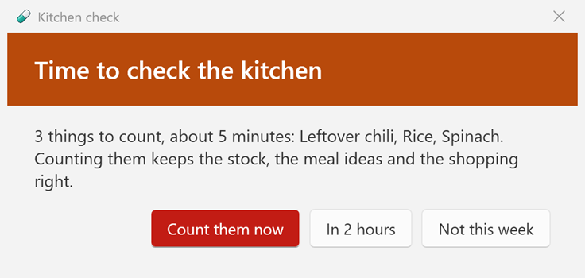

  

[health-reminder](../README.md) › [Manual](README.md) › Kitchen check

# Kitchen check

Counts drift: amounts read from photos are guesses, more can be used than was counted, and things go uncounted for
weeks. Once a week, at the time set at the foot of [your kitchen](kitchen.md) (Sunday at 10:00 to begin with), if
something's in doubt, this comes up in the middle of the screen, and rings once with the meals sound.

**Time to check the kitchen**, with how many things and about how long it takes (three quarters of a minute a thing,
5 minutes at least), and the first few by name: **4 things to count, about 5 minutes: Cheddar cheese, Peanut butter,
Salmon fillets, Milk. Counting them keeps the stock, the meal ideas and the shopping right.**

| | |
|---|---|
| **Count them now** | opens your kitchen showing just what's to check. Each goes from the list as it's counted |
| **Print a list** | the same, and a list of them to take round the kitchen and write on ([Print](print.md)) |
| **In 2 hours** | it comes back then |
| **Not this week** | not until next week's time |

Something is in doubt when its amount was read from a photo, more was used than was counted, or it hasn't been counted
for two weeks. It comes up only within 12 hours of the time set, only while tracking is on, and only when **Set time
aside to check the kitchen, when something's in doubt, on** is ticked.

← [Picture](picture.md) · [Contents](README.md) · [Log food](log-food.md) →

<!-- strongthium-links -->

---

<b>Strongthium open-source tools:</b> <a href="https://github.com/strongthium/emudhra-security-patch">eMudhra Security Patch</a> · <a href="https://github.com/strongthium/folder-size">Folder Size</a> · <b>Health Reminder</b> · <a href="https://github.com/strongthium/host-dossier">Host Dossier</a> · <a href="https://github.com/strongthium/outbound-watch">Outbound Watch</a> · <a href="https://github.com/strongthium/raw-convert">RAW Convert</a> · <a href="https://github.com/strongthium/video-dispatch">Video Dispatch</a> · <a href="https://github.com/strongthium/webdav-server">WebDAV Server</a> 
<b>More from Strongthium:</b> <a href="https://strongthium.com/linux-server-firewall">Guard</a> · <a href="https://strongthium.com/self-hosted-mail-server">Mail</a> · <a href="https://strongthium.com/self-hosted-live-chat">Chat</a> · <a href="https://strongthium.com/windows-ssh-client">Remote</a> · <a href="https://strongthium.com/twilio-sms-desktop-app">SMS</a> · <a href="https://strongthium.com/time-tracking-invoicing-software">Work</a> · <a href="https://strongthium.com/windows-registry-editor">Registry</a> · <a href="https://strongthium.com/cfml-server">DotCF</a> · <a href="https://strongthium.com/video-conferencing-dial-up-modem">Convey</a> 
<a href="https://strongthium.com">Strongthium Labs</a> · Take back control of your internet.

