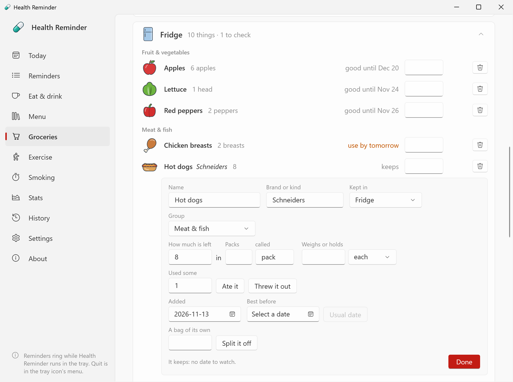

  

[health-reminder](../README.md) › [Manual](README.md) › Your kitchen

# Your kitchen

A running stock of what's in the fridge, the freezer and the cupboards, at the foot of the [Groceries](groceries.md)
page. What's bought (**Got it**), what's in grocery photos, and what's added with **I have it** goes in; the meals
cooked take off what their recipes use (**Cooked it** in [the steps](cooking.md), or a meal marked eaten when the menu
had a recipe for it, once a meal either way), and so does food logged as eaten from it.

Each thing is kept in its own unit: eggs by the egg, bread by the slice (a loaf being 20), ground beef by the gram, milk
by the millilitre. The [Menu](menu.md)'s shopping, **Use soon** and Claude's ideas go by it.

## The heading

**Your kitchen**, with how many things, and **6 to check** when some are in doubt. Clicking **6 to check** shows just
those (**Show everything** shows the rest again).

| | |
|---|---|
| **Sort** | the order things are in, in each group: **By name**, **Best before first**, **Newest first**, **Oldest first** or **By brand** |
| **Pick** | puts a box on each line to pick things, to move them together (below); **Done picking** ends it |
| **Places** | the places things are kept, to add, name, order and take away (below) |
| **Print** | a list to take round the kitchen and write on ([Print](print.md)) |

## By place, then by group

A card for each place (**Freezer**, **Fridge**, **Pantry**, **Cupboard** and **Counter** to begin with), with how many
things are in it and how many to check. Its heading folds it away and opens it again. Inside, the things are by group:
**Fruit & vegetables**, **Meat & fish**, **Dairy & eggs**, beverages (pop, juice, milk, cream), bread, meals and
leftovers, dry goods (pasta, rice, cans), snacks, condiments and spreads, and spices.

Where a thing goes, its group and its picture come from its name: "Coke" is a beverage in the pantry, "Garlic powder"
a spice in the cupboard, "Frozen broccoli" a vegetable in the freezer, "Cheez Whiz" a spread in the fridge, each with a
picture in the colour its name says (red for Coke, blue for Pepsi).

## A line

| | |
|---|---|
| **The picture** | a badge **!** on it when it's in doubt. Clicking it changes the picture and its colour ([Picture](picture.md)) |
| **The name**, the brand, how much | **Hot dogs** *Schneiders* **8** |
| **Best before** | **good until Dec 20**, **good until Jul 2027**, **keeps** (cans, rice, pasta), **use by tomorrow**, **use today**, or **past its best Nov 12**, in orange and red as it gets close |
| **The box** | to count it: type how much there is now, in any unit (`3`, `500 g`, `half a loaf`), and press **Enter** or **Set**. Shown when the page is wide enough |
| **✓** | while it's in doubt: the amount shown is right |
| **The bin** | none left: takes it off |

Hovering over a line says when it was added or frozen, when it was counted, and whether the amount is a guess.

## A line opened

A click on a line opens it in place, to change everything about it. What's typed is kept when you leave each box;
**Done** closes it.

| | |
|---|---|
| **Name** | renamed, it keeps its history under the new name |
| **Brand or kind** | which one it is: Schneiders, Chudleys, the 2% one… |
| **Kept in** | the place. Into a freezer, it's frozen from today; out of one, it's thawed from today |
| **Group** | the group it's shown in |
| **How much is left** | what there is now: `2`, `8`, `300 g`, `½`. What was eaten before it was in the app, or what's left after some went bad, goes here |
| **in Packs called** | how many packs, boxes or bags it's in, and what one is called (pack, box, bag, tray); optional |
| **Weighs or holds** | what one piece weighs or holds (**each**), or a whole pack (**a pack**) **of** so many: *2 in 1 box, 200 g each* makes 400 g; *8 in 1 pack, a 500 g pack of 12* makes a hot dog about 42 g. What it comes to shows beside it: **333 g in all** |
| **Used some** | how much of it was used (a serving is filled in: 60 g of rice, 1 egg; for what's weighed, 1 is a serving). **Ate it** takes it off and puts it in today's food log with about its kcal (taken out of the log, it goes back); **Threw it out** takes it off without logging it. It says what's left: **Ate 1, about 150 kcal, in today's food log.** |
| **Added** | when it was bought, put in or thawed |
| **Into the freezer** | when it went into the freezer, for what's frozen |
| **Best before** | set another date by hand; **Usual date** puts back the one worked out |
| **A bag of its own** and **Split it off** | makes part of it a thing of its own, beside this one, with its own place and dates: a 900 g bag kept apart from a 1.5 kg one |
| **Put the other … with it** | when there are others of its name: puts them back with this one, as one, their amounts added up |

Under them it says how the best-before was worked out: **Worked out from when it was added, for as long as it keeps
where it's kept.**, **Worked out from when it went in the freezer, for as long as it's at its best frozen.**, **Set by
hand: it stays, frozen or not, until it's put back to the usual date.**, or **It keeps: no date to watch.**

A weight of something counted (50 g of a bag of chips) comes off by what one weighs: a piece, a whole pack when that's
what's counted, or roughly a usual one (an egg, a slice); when that isn't known, it asks rather than taking off
nothing. A recipe takes from the bag of a thing that's best used first, then the next.

## Moving things together

**Pick** puts a box on each line, and **pick all** on each group. A bar floats at the foot of the page with how many are
picked:

| | |
|---|---|
| **Move to** | another place: into a freezer they're frozen from today, out of one thawed |
| **Group** | another group |
| **Take off** | none of these left |
| **Done** | stops picking |

A line, or what's picked with it, can also be dragged onto another place's card.

## Places

**Places** opens a card of the places, in the order they're shown: **Where things are kept, in the order they're
shown. What's in a freezer is frozen: its best-before is how long it keeps frozen.** Each has its name (rename it: a
**Deep freezer**, a **Garage fridge**), what kind of place it is (freezer, fridge, pantry, cupboard, counter), how many
things are in it, **↑** and **↓** to move it, and the bin to take it away; what was in it goes where its kind goes. The
last place can't be taken away. Under them, a name, a kind and **Add a place** add one.

## Best before

Each thing's best-before is worked out from when it was added, for as long as it keeps where it's kept: chicken breasts
2 days in the fridge, eggs 4 weeks, butter 2 months, bread 6 days on the counter; cans, rice and pasta keep. Moving the
day it was added, or the day it went into the freezer, moves the best-before with it, unless that was set by hand.

**In the freezer**, the best-before is from the day it went in, for as long as it's at its best frozen at −18 °C
(0 °F): 9 months for chicken breasts, 6 for steak, 3 for ground beef, bread and milk, 2 for salmon (from the USDA's
FoodKeeper). Frozen food stays safe longer than that, but drier and blander. What's sold frozen goes straight in.
Moved out of the freezer, it's thawed, and keeps from then as it does fresh. Lettuce, salad greens, cucumbers and
potatoes don't freeze well, and say so.

How cold the fridge and freezer are set (in [Settings](settings.md)) changes the dates: warmer, food keeps less long.

## What's in doubt

Counts drift, so what's in doubt has a badge on its picture: an amount read from a photo, more used than was counted,
or not counted for two weeks. Count it on the spot (type what there is and **Set** it, say the amount is right with
**✓**, or take it off as none left), and the badge goes.

Under the places:

| | |
|---|---|
| **Set time aside to check the kitchen, when something's in doubt, on** | a day and a time each week (Sunday at 10:00 to begin with). When something's in doubt then, the [Kitchen check](kitchen-check.md) comes up |

← [Is this right?](is-this-right.md) · [Contents](README.md) · [Put it away](put-away.md) →

<!-- strongthium-links -->

---

<b>Strongthium open-source tools:</b> <a href="https://github.com/strongthium/emudhra-security-patch">eMudhra Security Patch</a> · <a href="https://github.com/strongthium/folder-size">Folder Size</a> · <b>Health Reminder</b> · <a href="https://github.com/strongthium/host-dossier">Host Dossier</a> · <a href="https://github.com/strongthium/outbound-watch">Outbound Watch</a> · <a href="https://github.com/strongthium/raw-convert">RAW Convert</a> · <a href="https://github.com/strongthium/video-dispatch">Video Dispatch</a> · <a href="https://github.com/strongthium/webdav-server">WebDAV Server</a> 
<b>More from Strongthium:</b> <a href="https://strongthium.com/linux-server-firewall">Guard</a> · <a href="https://strongthium.com/self-hosted-mail-server">Mail</a> · <a href="https://strongthium.com/self-hosted-live-chat">Chat</a> · <a href="https://strongthium.com/windows-ssh-client">Remote</a> · <a href="https://strongthium.com/twilio-sms-desktop-app">SMS</a> · <a href="https://strongthium.com/time-tracking-invoicing-software">Work</a> · <a href="https://strongthium.com/windows-registry-editor">Registry</a> · <a href="https://strongthium.com/cfml-server">DotCF</a> · <a href="https://strongthium.com/video-conferencing-dial-up-modem">Convey</a> 
<a href="https://strongthium.com">Strongthium Labs</a> · Take back control of your internet.

