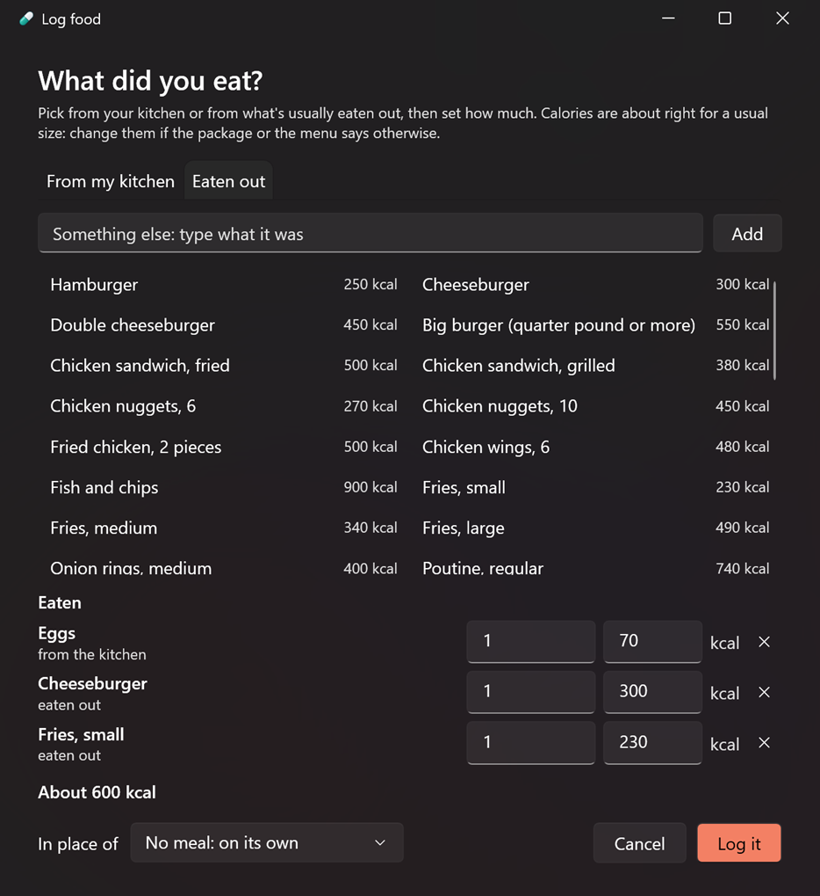

  

[health-reminder](../README.md) › [Manual](README.md) › Log food

# Log food

For what isn't on the menu: something from your kitchen, fast food, a snack. Each has about how many calories, which
you can change, and what's eaten from the kitchen comes off what you have.

It opens from **Log food** on [Today](today.md), **Log food…** in the tray icon's menu, and **Something else…** on a
meal's [reminder](alarm.md).

## What did you eat?

Pick from your kitchen or from what's usually eaten out, then set how much. Calories are about right for a usual size:
change them if the package or the menu says otherwise.

| | |
|---|---|
| **From my kitchen** | what's in [your kitchen](kitchen.md), by name, each with how much there is and about how many kcal in a usual amount: **9 eggs there · about 72 kcal in one**. **Find in the kitchen** narrows it. Clicking one adds it below |
| **Eaten out** | the usual things eaten out, in a usual size, each with about how many kcal: a cheeseburger, medium fries, a poutine, a slice of pizza, a double-double… Clicking one adds it below. **Something else: type what it was** and **Add** (or **Enter**) adds anything else, without kcal until you type them |

## Eaten

What's being logged, a line each:

| | |
|---|---|
| **The name** | and whether it's **from the kitchen** or **eaten out** |
| **How much** | `2`, `150 g`, `1 cup`. The kcal follow the amount, until you type them yourself |
| **kcal** | about how many |
| **✕** | takes it out |

Under them: **About 1,080 kcal**, **and 1 without kcal** for what has none.

## Logging it

| | |
|---|---|
| **In place of** | **No meal: on its own**, or one of today's meals not yet answered (**Dinner at 20:00**). In place of a meal, the meal counts as eaten, and its recipe doesn't come off the kitchen. From a meal's reminder, that meal is chosen |
| **Cancel** | logs nothing |
| **Log it** | logs it, at this time. From the kitchen, what was eaten comes off what there is |

What's logged is on [Today](today.md), under **Eaten today**, and counts in the [Stats](stats.md). Taking it out of the
log there (its **✕**) puts back what came off the kitchen.

Values are typical ones from the USDA's FoodData Central and the chains' published nutrition, rounded: an egg about
72 kcal, rice 360 kcal in 100 g dry, a can of pop 150. Sizes and brands differ, so they're a guide.

← [Kitchen check](kitchen-check.md) · [Contents](README.md) · [Exercise](exercise.md) →

<!-- strongthium-links -->

---

<b>Strongthium open-source tools:</b> <a href="https://github.com/strongthium/emudhra-security-patch">eMudhra Security Patch</a> · <a href="https://github.com/strongthium/folder-size">Folder Size</a> · <b>Health Reminder</b> · <a href="https://github.com/strongthium/host-dossier">Host Dossier</a> · <a href="https://github.com/strongthium/outbound-watch">Outbound Watch</a> · <a href="https://github.com/strongthium/raw-convert">RAW Convert</a> · <a href="https://github.com/strongthium/video-dispatch">Video Dispatch</a> · <a href="https://github.com/strongthium/webdav-server">WebDAV Server</a> 
<b>More from Strongthium:</b> <a href="https://strongthium.com/linux-server-firewall">Guard</a> · <a href="https://strongthium.com/self-hosted-mail-server">Mail</a> · <a href="https://strongthium.com/self-hosted-live-chat">Chat</a> · <a href="https://strongthium.com/windows-ssh-client">Remote</a> · <a href="https://strongthium.com/twilio-sms-desktop-app">SMS</a> · <a href="https://strongthium.com/time-tracking-invoicing-software">Work</a> · <a href="https://strongthium.com/windows-registry-editor">Registry</a> · <a href="https://strongthium.com/cfml-server">DotCF</a> · <a href="https://strongthium.com/video-conferencing-dial-up-modem">Convey</a> 
<a href="https://strongthium.com">Strongthium Labs</a> · Take back control of your internet.

