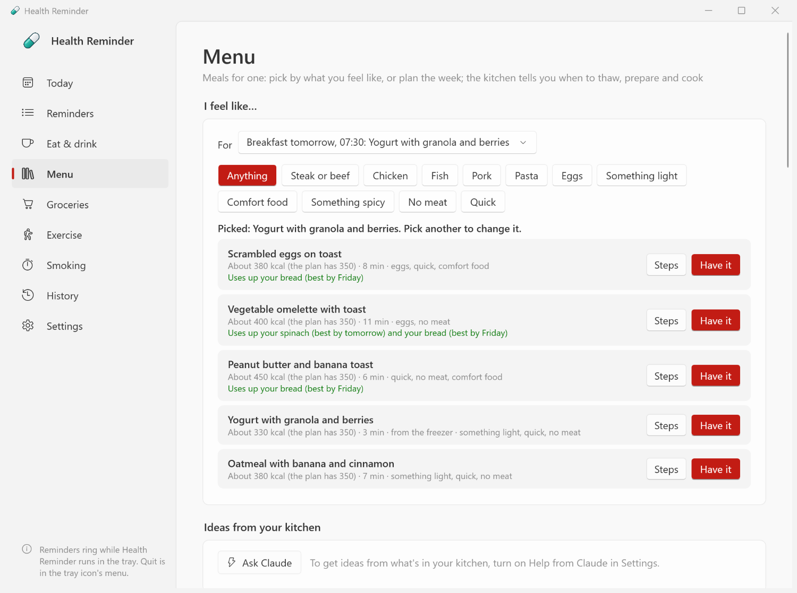
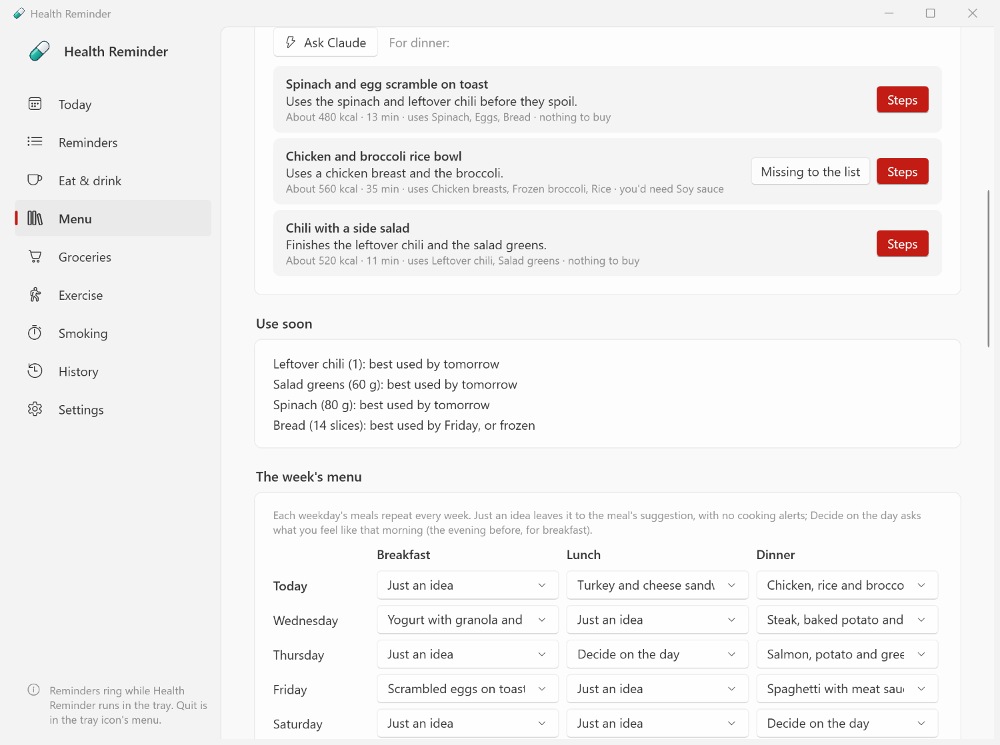
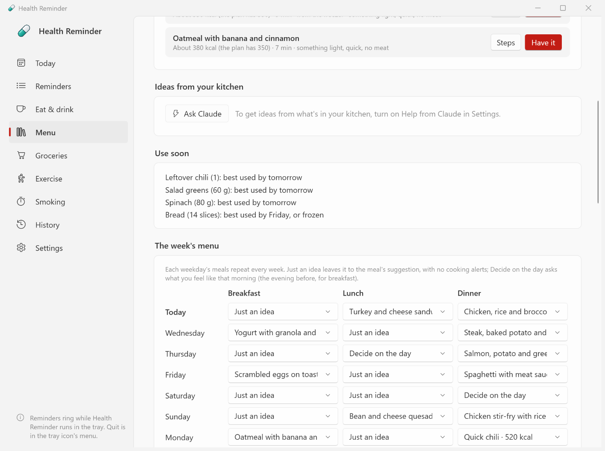
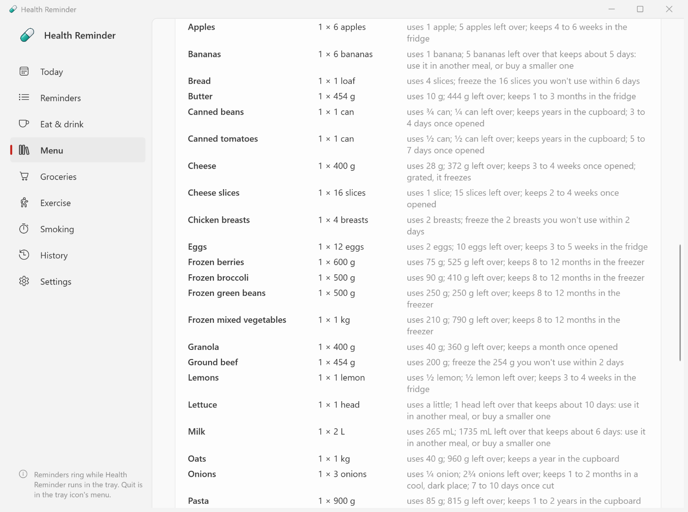

  

[health-reminder](../README.md) › [Manual](README.md) › Menu

# Menu

Meals for one person cooking for themself: pick by what you feel like, or plan the week; the kitchen then tells you
when to thaw, prepare and cook. The meals are the meal reminders' (from [Eat & drink](eat-drink.md), or added by hand),
at their times and calories.

The menu has 22 plain recipes for one, from everyday groceries, each with its ingredients in the amounts they're used
in (85 g of dry pasta, not cups of spaghetti), how long it takes to prepare and cook, its steps, and for meat and fish
the safe temperature to cook to: poultry 74 °C (165 °F), ground meat 71 °C (160 °F), whole cuts and fish 63 °C
(145 °F).

With no meal reminders yet, the page says so, and **Go to Eat & drink** opens that page.

## I feel like…

| | |
|---|---|
| **For** | the meal to choose for: what's still to come today, and tomorrow's: **Dinner today, 20:00: Chicken, rice and broccoli** |
| **What you feel like** | **Anything**, **Steak or beef**, **Chicken**, **Fish**, **Pork**, **Pasta**, **Eggs**, **Something light**, **Comfort food**, **Something spicy**, **No meat** or **Quick** |
| **The recipes** | those for that meal that fit, closest to its calories first, and first of all those that use up something bought that won't keep (**Uses up your bread (best by tomorrow)**). Each has about how many kcal, how long, and whether something comes from the freezer |
| **Steps** | opens the recipe's steps at the side of the screen ([Cooking](cooking.md)) |
| **Have it** | picks it for that meal: **Picked: Chicken, rice and broccoli. Pick another to change it.** The kitchen alerts follow from it |

## Ideas from your kitchen

With **Help from Claude** on in [Settings](settings.md), **Ask Claude** gives three ideas for the meal chosen above and
what you feel like, from what's in [your kitchen](kitchen.md), using first what won't keep. Each has why, about how
many kcal and how long, what it uses from the kitchen, and what you'd need to buy (or **nothing to buy**).

| | |
|---|---|
| **Missing to the list** | puts what you'd need on the [grocery list](groceries.md) |
| **Steps** | opens its timed steps at the side of the screen |

Without Help from Claude it says **To get ideas from what's in your kitchen, turn on Help from Claude in Settings.**
What's sent to Anthropic is on [Your data](your-data.md).

## Use soon

What's in the kitchen that's near the end of how long it keeps, with when: **Chicken breasts (2 breasts): best used by
tomorrow, or frozen**. Shown when there's something.

## The week's menu

A row for each of the next 7 days, from today, and a column for each meal (not the snacks). Each weekday's meals repeat
every week. In each:

| | |
|---|---|
| **Just an idea** | the meal's everyday suggestion, with no cooking and no kitchen alerts |
| **Decide on the day** | it asks what you feel like that morning (the evening before, for breakfast): see [In the kitchen](kitchen-alerts.md) |
| **A recipe** | **Chicken, rice and broccoli · 580 kcal**: the kitchen alerts are timed back from the meal |

A **–** is a day that meal's reminder doesn't ring. What's picked for a single day (with **Have it**, or on a meal's
alarm) is listed under the grid: **Picked for a single day, over the menu: today's dinner: …**

## Shopping for the next 7 days

What the next 7 days' recipes need, in the packs it's sold in (a dozen eggs, a 454 g pack of ground beef, 4 chicken
breasts), each with how much the recipes use and what's left over: fresh meat to freeze in portions the day it's
bought, and a warning when part of a pack would spoil before it's used. What's kept on hand (salt, oil…) says
**on hand**.

**Add them to my grocery list** puts the packs on the [grocery list](groceries.md), leaving out what's kept on hand and
what's on the list already: **Added 6 to your grocery list.**

## Kitchen alerts

| | |
|---|---|
| **Kitchen alerts** | when to take food out of the freezer, when it's thawed, and when to start preparing and cooking each meal on the menu. They ring once, with the meals sound, and are on [Today](today.md) too |
| **Thawing: In the fridge** | the safest: out of the freezer the night before or that morning (moved to before bed if it would fall in the night) |
| **Thawing: In cold water** | about an hour for one portion, sealed in a bag, the water changed every 30 minutes (it reminds you). A meal picked too late for the fridge thaws in cold water |
| **Open the recipe's steps at the side of the screen when it's time to start** | |
| **Keep the steps in front of other windows** | |

← [Eat & drink](eat-drink.md) · [Contents](README.md) · [In the kitchen](kitchen-alerts.md) →

<!-- strongthium-links -->

---

<b>Strongthium open-source tools:</b> <a href="https://github.com/strongthium/emudhra-security-patch">eMudhra Security Patch</a> · <a href="https://github.com/strongthium/folder-size">Folder Size</a> · <b>Health Reminder</b> · <a href="https://github.com/strongthium/host-dossier">Host Dossier</a> · <a href="https://github.com/strongthium/outbound-watch">Outbound Watch</a> · <a href="https://github.com/strongthium/raw-convert">RAW Convert</a> · <a href="https://github.com/strongthium/video-dispatch">Video Dispatch</a> · <a href="https://github.com/strongthium/webdav-server">WebDAV Server</a> 
<b>More from Strongthium:</b> <a href="https://strongthium.com/linux-server-firewall">Guard</a> · <a href="https://strongthium.com/self-hosted-mail-server">Mail</a> · <a href="https://strongthium.com/self-hosted-live-chat">Chat</a> · <a href="https://strongthium.com/windows-ssh-client">Remote</a> · <a href="https://strongthium.com/twilio-sms-desktop-app">SMS</a> · <a href="https://strongthium.com/time-tracking-invoicing-software">Work</a> · <a href="https://strongthium.com/windows-registry-editor">Registry</a> · <a href="https://strongthium.com/cfml-server">DotCF</a> · <a href="https://strongthium.com/video-conferencing-dial-up-modem">Convey</a> 
<a href="https://strongthium.com">Strongthium Labs</a> · Take back control of your internet.

