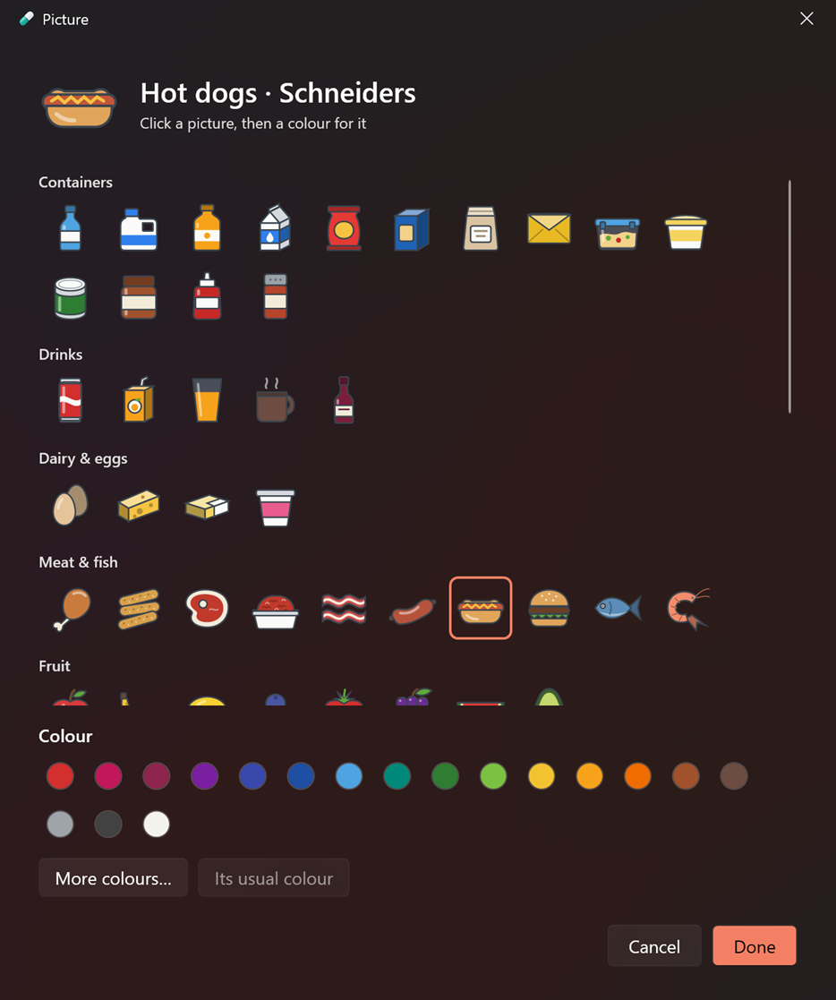

  

[health-reminder](../README.md) › [Manual](README.md) › Picture

# Picture

Opened by clicking a thing's picture in [your kitchen](kitchen.md): another picture for it, by kind, and another
colour.

| | |
|---|---|
| **The heading** | the picture as it will be, the name and the brand, and **Click a picture, then a colour for it** |
| **The pictures** | over seventy, by kind: containers (a bottle, a jug, a carafe, a carton, a sack, an envelope, a glass container…), drinks, meat and fish, bread (a loaf, a baguette, a bun, a bagel…) and the rest. Hovering over one says what it is; the one in use is outlined |
| **Colour** | a row of colours to pick from; the one in use is outlined |
| **More colours…** | any colour, from Windows' colour picker |
| **Its usual colour** | back to the colour its name says (red for Coke, blue for Pepsi), or the picture's own |
| **Cancel** | leaves it as it was |
| **Done** | keeps the picture and colour |

← [Put it away](put-away.md) · [Contents](README.md) · [Kitchen check](kitchen-check.md) →

<!-- strongthium-links -->

---

<b>Strongthium open-source tools:</b> <a href="https://github.com/strongthium/emudhra-security-patch">eMudhra Security Patch</a> · <a href="https://github.com/strongthium/folder-size">Folder Size</a> · <b>Health Reminder</b> · <a href="https://github.com/strongthium/host-dossier">Host Dossier</a> · <a href="https://github.com/strongthium/outbound-watch">Outbound Watch</a> · <a href="https://github.com/strongthium/raw-convert">RAW Convert</a> · <a href="https://github.com/strongthium/video-dispatch">Video Dispatch</a> · <a href="https://github.com/strongthium/webdav-server">WebDAV Server</a> 
<b>More from Strongthium:</b> <a href="https://strongthium.com/linux-server-firewall">Guard</a> · <a href="https://strongthium.com/self-hosted-mail-server">Mail</a> · <a href="https://strongthium.com/self-hosted-live-chat">Chat</a> · <a href="https://strongthium.com/windows-ssh-client">Remote</a> · <a href="https://strongthium.com/twilio-sms-desktop-app">SMS</a> · <a href="https://strongthium.com/time-tracking-invoicing-software">Work</a> · <a href="https://strongthium.com/windows-registry-editor">Registry</a> · <a href="https://strongthium.com/cfml-server">DotCF</a> · <a href="https://strongthium.com/video-conferencing-dial-up-modem">Convey</a> 
<a href="https://strongthium.com">Strongthium Labs</a> · Take back control of your internet.

