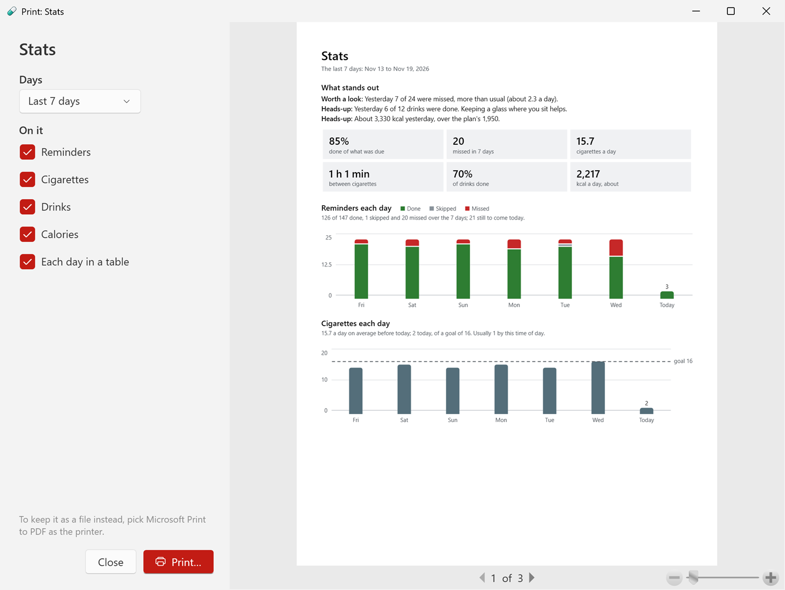
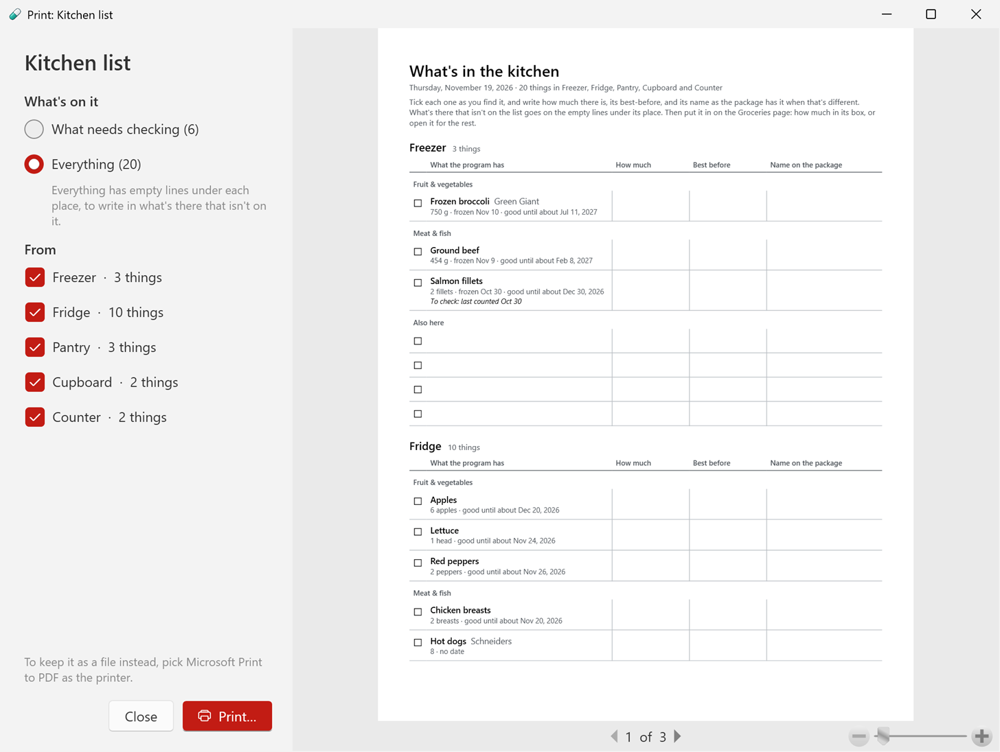

  

[health-reminder](../README.md) › [Manual](README.md) › Print

# Print

Four things can be printed, in black on white: the kitchen list, the grocery list, the stats and the smoking. Each
opens this window, titled **Print:** and what it is: on the left, what goes on the pages; on the right, the pages as
they'll print, on the default printer's paper (Letter, when there's no printer).

| | |
|---|---|
| **The options** | on the left, below; the pages change as soon as one does |
| **The pages** | the arrows below them go from page to page; the slider zooms |
| **Print…** | Windows' print dialog, to pick a printer and print. Each page has the title, the date and **page 2 of 3** at its foot. To keep it as a file instead, pick **Microsoft Print to PDF** as the printer |
| **Close** | closes it without printing |

## Kitchen list

From **Print** beside **Your kitchen** on [Groceries](groceries.md), and **Print a list** on the
[Kitchen check](kitchen-check.md). A list to take round the fridge and cupboards and write on.

| | |
|---|---|
| **What's on it** | **What needs checking (6)**, or **Everything (20)**. Everything has empty lines under each place, to write in what's there that isn't on it |
| **From** | the places, each with how many things (or to check) are in it. The places left off are remembered for next time |

On the pages: **Kitchen check** or **What's in the kitchen**, the date, how many things in which places, and how to use
it. Then by place, and in each by group as the page has them, a line each: a box to tick, **What the program has** (how
much, when it was frozen, its best-before, and why it's to be checked), and room to write **How much**, **Best before**
and its **Name on the package**. The empty lines are under **Also here**.

## Grocery list

From **Print** beside **To buy** on [Groceries](groceries.md). The list to take to the store.

| | |
|---|---|
| **By section, as a store has them** | fruit and vegetables, meat and fish, dairy and eggs…, each thing where your kitchen keeps it; unticked, one list |
| **What each cost the last time** | under each thing |

On the pages: **Grocery list**, the date and how many things to buy, then a line each with a box to tick, **What**,
**How much** and room to write what it cost (**Paid**). Empty lines at the end, under **Also**, are for what you think
of at the store.

## Stats

From **Print** on [Stats](stats.md).

| | |
|---|---|
| **Days** | **Last 7 days**, **Last 14 days** or **Last 30 days** |
| **On it** | **Reminders**, **Cigarettes**, **Drinks**, **Calories**, **Each day in a table** |

On the pages: the days it covers, **What stands out**, the numbers, the charts ticked, each day in a table (**Day**,
**Done**, **Skipped**, **Missed**, **Cigarettes**, **One every**, **Drinks**, **kcal**), and **What was missed**, by name
and time.

## Smoking

From **Print** on [Smoking](smoking.md).

| | |
|---|---|
| **Days** | **Last 7 days**, **Last 14 days** or **Last 30 days** |

On the pages: the brand and its price, the numbers (today, a day over the last 7 days, since the last one, a week at
this rate), **Cutting down**, **Time per cigarette**, **The first of the day**, the charts of cigarettes each day and
the time between them, and each day in a table: **Day**, **Cigarettes**, **One every**, **First**, **Last**.

## When it goes wrong

| | |
|---|---|
| **The pages couldn't be made:** … | shown in place of the pages; **Print…** is greyed |
| **It couldn't be printed:** … | the printer, or Windows' print dialog, didn't take it |

← [Stats](stats.md) · [Contents](README.md) · [Settings](settings.md) →

<!-- strongthium-links -->

---

<b>Strongthium open-source tools:</b> <a href="https://github.com/strongthium/emudhra-security-patch">eMudhra Security Patch</a> · <a href="https://github.com/strongthium/folder-size">Folder Size</a> · <b>Health Reminder</b> · <a href="https://github.com/strongthium/host-dossier">Host Dossier</a> · <a href="https://github.com/strongthium/outbound-watch">Outbound Watch</a> · <a href="https://github.com/strongthium/raw-convert">RAW Convert</a> · <a href="https://github.com/strongthium/video-dispatch">Video Dispatch</a> · <a href="https://github.com/strongthium/webdav-server">WebDAV Server</a> 
<b>More from Strongthium:</b> <a href="https://strongthium.com/linux-server-firewall">Guard</a> · <a href="https://strongthium.com/self-hosted-mail-server">Mail</a> · <a href="https://strongthium.com/self-hosted-live-chat">Chat</a> · <a href="https://strongthium.com/windows-ssh-client">Remote</a> · <a href="https://strongthium.com/twilio-sms-desktop-app">SMS</a> · <a href="https://strongthium.com/time-tracking-invoicing-software">Work</a> · <a href="https://strongthium.com/windows-registry-editor">Registry</a> · <a href="https://strongthium.com/cfml-server">DotCF</a> · <a href="https://strongthium.com/video-conferencing-dial-up-modem">Convey</a> 
<a href="https://strongthium.com">Strongthium Labs</a> · Take back control of your internet.

