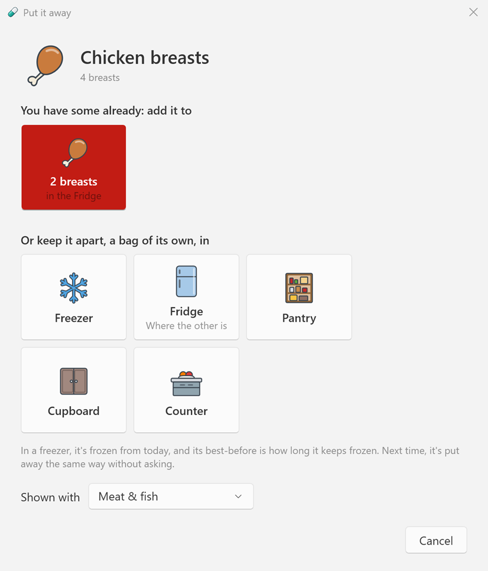

  

[health-reminder](../README.md) › [Manual](README.md) › Put it away

# Put it away

Asked the first time something is put in [your kitchen](kitchen.md) by hand (**Got it** or **I have it** on
[Groceries](groceries.md)): where it goes, and the group it's shown with. Next time the same thing is put away the same
way without asking.

| | |
|---|---|
| **The heading** | its picture, its name, and how much is going in |
| **You have some already: add it to** | when there's some of it in the kitchen already: a button for each, with how much and where (**2 breasts in the Fridge**). Clicking one adds it to that |
| **Where does it go?** | a button for each place, in the order of your places; a place you've renamed says what kind it is under its name. The one its name says stands out, marked **Where it usually goes**, and **Enter** takes it. With some there already the heading is **Or keep it apart, a bag of its own, in**, and the place of the other is marked **Where the other is** |
| **Shown with** | the group it's shown in, as its name says to begin with |
| **Cancel** | puts nothing away, and leaves what was on the list still to buy |

In a freezer, it's frozen from today, and its best-before is how long it keeps frozen. Kept apart, a 900 g bag and a
1.5 kg one of the same thing are two lines, each with its own place and dates. With some there already, **Enter** keeps
apart what's weighed or poured, and adds what's counted, like eggs or cans.

← [Your kitchen](kitchen.md) · [Contents](README.md) · [Picture](picture.md) →

<!-- strongthium-links -->

---

<b>Strongthium open-source tools:</b> <a href="https://github.com/strongthium/emudhra-security-patch">eMudhra Security Patch</a> · <a href="https://github.com/strongthium/folder-size">Folder Size</a> · <b>Health Reminder</b> · <a href="https://github.com/strongthium/host-dossier">Host Dossier</a> · <a href="https://github.com/strongthium/outbound-watch">Outbound Watch</a> · <a href="https://github.com/strongthium/raw-convert">RAW Convert</a> · <a href="https://github.com/strongthium/video-dispatch">Video Dispatch</a> · <a href="https://github.com/strongthium/webdav-server">WebDAV Server</a> 
<b>More from Strongthium:</b> <a href="https://strongthium.com/linux-server-firewall">Guard</a> · <a href="https://strongthium.com/self-hosted-mail-server">Mail</a> · <a href="https://strongthium.com/self-hosted-live-chat">Chat</a> · <a href="https://strongthium.com/windows-ssh-client">Remote</a> · <a href="https://strongthium.com/twilio-sms-desktop-app">SMS</a> · <a href="https://strongthium.com/time-tracking-invoicing-software">Work</a> · <a href="https://strongthium.com/windows-registry-editor">Registry</a> · <a href="https://strongthium.com/cfml-server">DotCF</a> · <a href="https://strongthium.com/video-conferencing-dial-up-modem">Convey</a> 
<a href="https://strongthium.com">Strongthium Labs</a> · Take back control of your internet.

