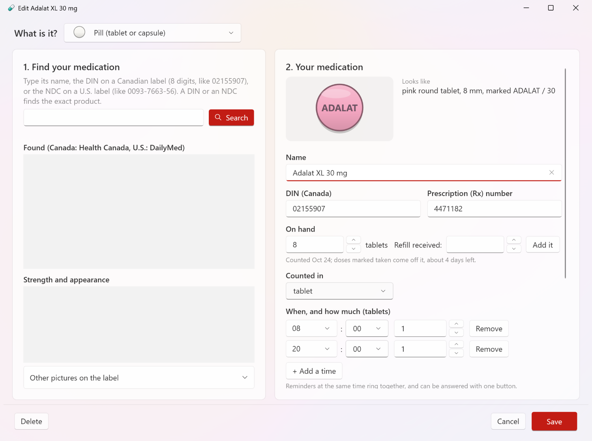
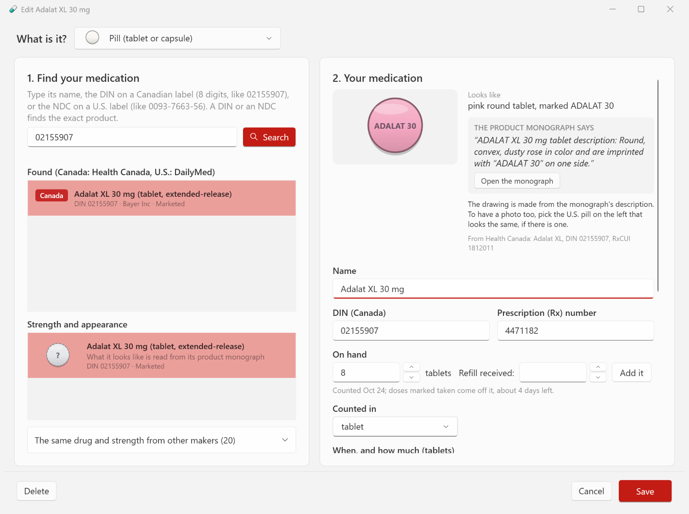
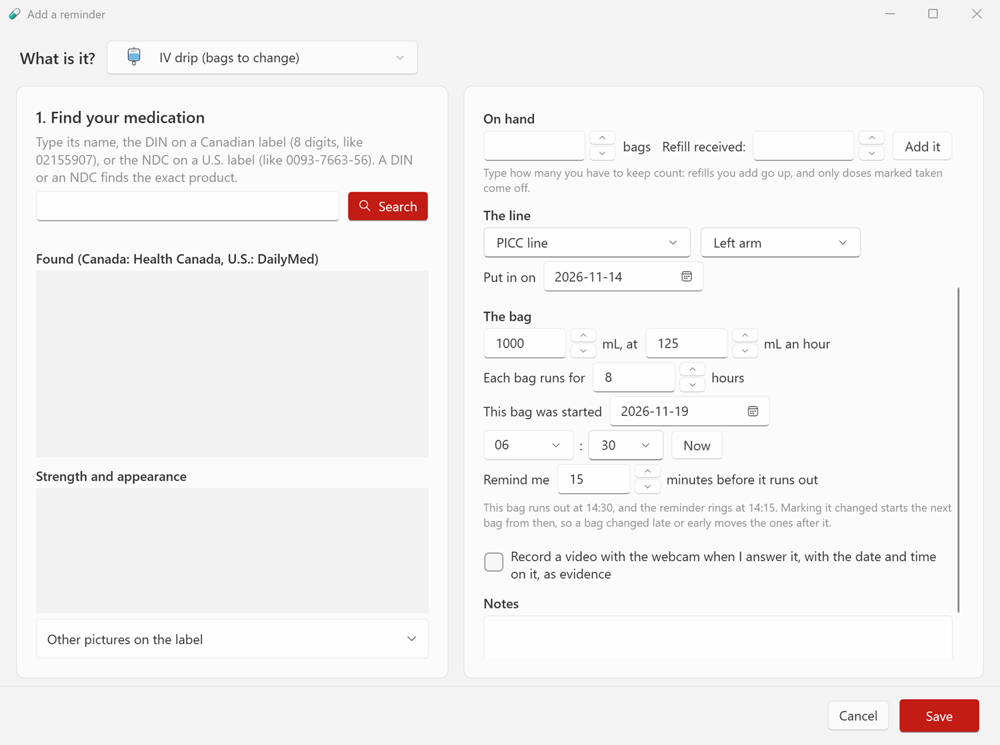

  

[health-reminder](../README.md) › [Manual](README.md) › Add a reminder

# Add a reminder

The window for adding a reminder (**Add reminder**, on [Today](today.md) and [Reminders](reminders.md)) or changing one
(**Edit**, on Reminders, where its title is **Edit** and the reminder's name). For a medication it has two sides: on
the left, **1. Find your medication**, which looks it up; on the right, **2. Your medication**, which is what's saved.
For anything else there's only the right side.

## What is it?

The list at the top. It decides what the rest of the window asks for.

| Kind | Counted in | Asks for |
|---|---|---|
| **Pill (tablet or capsule)** | tablet, capsule, softgel, lozenge | the lookup, what it looks like, how many are on hand |
| **Injection (insulin, pen, syringe)** | unit, mL, mg, pen, syringe, dose | the lookup, the injection sites to rotate through, how many are on hand |
| **IV drip (bags to change)** | bag | the lookup, the line and the bags (below), instead of times |
| **Liquid medicine** | mL, teaspoon, tablespoon, drop | the lookup, how much is on hand |
| **Inhaler** | puff, dose | the same |
| **Eye or ear drops** | drop | the same |
| **Patch or cream** | patch, application | the same |
| **Other medication** | dose, tablet, sachet, spray, mL | the same |
| **Blood sugar test** | | the unit of the reading: mmol/L or mg/dL |
| **Blood pressure check** | | readings in mmHg |
| **Weigh myself** | | the unit of the reading: kg or lb |
| **Other check or measurement** | | |
| **Meal or snack** | kcal | |
| **Drink water** | the drinks unit in Settings | |
| **Something else** | | |

The first unit of a check is the one used in your country (mg/dL and lb in the U.S.). A new blood sugar test, blood
pressure check, weighing or drink starts with a name of its own (**Blood sugar test**, **Blood pressure**, **Weight**,
**Water**), which you can change.

## 1. Find your medication

Type its name, the **DIN** on a Canadian label (8 digits, like `02155907`) or the **NDC** on a U.S. label (like
`0093-7663-56`), and press **Search** or **Enter**. A DIN or an NDC finds the exact product.

| | |
|---|---|
| **Search** | a DIN is looked up in Health Canada's Drug Product Database; an NDC on DailyMed; a name in both. While it looks, it says so: **Looking the DIN up at Health Canada…** |
| **Found (Canada: Health Canada, U.S.: DailyMed)** | what was found, each with **Canada** or **U.S.**: a U.S. label (one or more strengths), with when it was published; or a Canadian product, with its DIN, its maker and its status. A product no longer sold is faded: a pharmacy may still have it. On a Canadian PC, or for a DIN, Canada's come first |
| **Strength and appearance** | the label's products, each drawn as the label describes it, with its NDC. Pick yours. A Canadian product is one strength, and is picked at once |
| **The same drug and strength from other makers** | folded away under the lists. Every maker's pill of the same drug and strength, as their U.S. labels describe it, each drawn (**On 3 U.S. labels**, **· with a photo**). Pick the one that looks like yours to use its look, and its photo if it has one |
| **Other pictures on the label** | for a U.S. label: every picture on it, to choose one by hand |

Picking a product fills in the name (**Adalat XL 30 mg**), the kind, the unit and what it looks like; for a Canadian
one, the DIN too. A name you typed yourself is kept.

**For a U.S. pill**, it then looks for a photo of that very pill: on its own label; for a repackaged pill, on the label of
the product it repackages; then on the other labels of the same drug and strength (through its RxNorm concept), for one
with the same imprint, shape and colour. What it's doing shows under the picture. If none is found it says
**DailyMed has no photo of this exact pill**, and the drawing is used.

**For a Canadian pill**, the database has no description and no photos, so it reads the product's monograph (the PDF
the database links to) for the sentence that describes the pill of that strength, and draws it from that.
**THE PRODUCT MONOGRAPH SAYS** quotes the sentence, and **Open the monograph** opens the PDF. To have a photo too, pick
the U.S. pill under **The same drug and strength from other makers** that looks the same, if there is one.

## 2. Your medication

| | |
|---|---|
| **The picture** | the drawing, and under it the photo that will be saved, if there is one |
| **Don't use a picture** | no photo: just the drawing. One can still be picked from the label's pictures on the left |
| **Looks like** | what it looks like, in words: **white oval tablet, 13 mm, scored in half, marked MF / 500**; or **Not known yet** |
| Under it | where the photo came from, and which label or product it's all from: **From Health Canada: Adalat XL, DIN 02155907, RxCUI …** or **From DailyMed: …, NDC …** |
| **Name** | what the reminder is called |
| **DIN (Canada)** | the 8-digit Drug Identification Number, for a medication |
| **Prescription (Rx) number** | the pharmacy's number for the prescription, from its label, for refills. It's the pharmacy's own and can't be looked up |
| **On hand** | how many you have now, in its unit. Leave it empty not to keep count. Only doses marked taken come off it, not skipped or missed ones |
| **Refill received:** and **Add it** | adds a refill to the count, and keeps it; the line under lists the last ones: **Counted Nov 1; doses marked taken come off it, about 24 days left. Refills: 30 tablets on Nov 12.** |
| **Counted in** | the unit (see the table above); you can type another |
| **Readings in** | for a check: what the reading is measured in |
| **When, and how much** | a line for each time of day it rings, with the amount then (**2** tablets in the morning, **1** at night). **Remove** takes a time away; **+ Add a time** adds one, 12 hours after the last (2 hours, for a drink). Reminders at the same time ring together, and can be answered with one button |
| **The days** | a button for each day of the week, in your week's order; all of them to begin with |
| **Injection sites to rotate through** | for an injection: tick the sites (**Abdomen, left**, **Abdomen, right**, **Thigh, left**, **Thigh, right**, **Arm, left**, **Arm, right**, **Buttock, left**, **Buttock, right**); the first four are ticked to begin with. Each reminder suggests the next site after the one used last |
| **Change how it looks** | for a pill: **Colour**, **Second colour** (a two-tone capsule), **Shape**, **Size (mm)**, **Imprint** (its sides separated by `;`, like `H;144`) and **Score** (**Not scored**, **Scored in half**, **Scored in thirds**, **Scored in quarters**). For a medicine that isn't on DailyMed or in Health Canada's database, describe it here |
| **Record a video with the webcam when I answer it** | answering it opens the webcam and records it being taken, with the date and time on it, as evidence (see [Record taking it](record.md)) |
| **Notes** | shown on the reminder: **Take with food** |
| **Remind me (untick to pause)** | unticked, it stays in the list, faded, and doesn't ring |

## An IV drip

An IV drip rings for its bags, not at times of day. In place of **When, and how much**:

| | |
|---|---|
| **The line** | the kind of line (**PICC line**, **Midline**, **Peripheral IV (cannula)**, **Implanted port**, **Central line**, or your own words) and where it goes in (**Left arm**, **Right hand**, **Neck**…) |
| **Put in on** | when the line was put in; leave it empty if you don't know |
| **The bag** | how much a bag holds, in mL, and the rate the pump is set to, in mL an hour |
| **Each bag runs for** | worked out from the bag and the rate; or type it, if you know how long a bag lasts. Half an hour at least |
| **This bag was started** | the day and the time; **Now** puts in this minute |
| **Remind me** | how many minutes before the bag runs out it rings: 15 to begin with |

The line under them says when: **This bag runs out at 14:30, and the reminder rings at 14:15.** Marking a bag changed
starts the next one from then, so a bag changed late or early moves the ones after it. The line each bag went in by is
kept in the [History](history.md).

## Saving

**Save** keeps it and closes the window; **Cancel** (or **Esc**) closes it without saving. **Delete**, for a reminder
that's already saved, asks once more (**Click again to delete**) and then deletes it. The videos recorded for it stay.

If something's missing, it says what, beside the buttons, and doesn't save:

| | |
|---|---|
| **Give it a name.** | |
| **Add a time to be reminded at, or untick "Remind me".** | |
| **Pick at least one day.** | |
| **Each time needs an amount above zero.** | |
| **The same time is there twice.** | |
| **Tick at least one injection site.** | |
| **A DIN is 8 digits.** | |
| **Say how long a bag runs: half an hour or more.** | an IV drip |
| **Say when this bag was started.** | an IV drip |
| **Couldn't save:** … | the data folder couldn't be written to |

What the lookups can say when they don't find something is on [Messages](messages.md).

← [Reminders](reminders.md) · [Contents](README.md) · [The reminder](alarm.md) →

<!-- strongthium-links -->

---

<b>Strongthium open-source tools:</b> <a href="https://github.com/strongthium/emudhra-security-patch">eMudhra Security Patch</a> · <a href="https://github.com/strongthium/folder-size">Folder Size</a> · <b>Health Reminder</b> · <a href="https://github.com/strongthium/host-dossier">Host Dossier</a> · <a href="https://github.com/strongthium/outbound-watch">Outbound Watch</a> · <a href="https://github.com/strongthium/raw-convert">RAW Convert</a> · <a href="https://github.com/strongthium/video-dispatch">Video Dispatch</a> · <a href="https://github.com/strongthium/webdav-server">WebDAV Server</a> 
<b>More from Strongthium:</b> <a href="https://strongthium.com/linux-server-firewall">Guard</a> · <a href="https://strongthium.com/self-hosted-mail-server">Mail</a> · <a href="https://strongthium.com/self-hosted-live-chat">Chat</a> · <a href="https://strongthium.com/windows-ssh-client">Remote</a> · <a href="https://strongthium.com/twilio-sms-desktop-app">SMS</a> · <a href="https://strongthium.com/time-tracking-invoicing-software">Work</a> · <a href="https://strongthium.com/windows-registry-editor">Registry</a> · <a href="https://strongthium.com/cfml-server">DotCF</a> · <a href="https://strongthium.com/video-conferencing-dial-up-modem">Convey</a> 
<a href="https://strongthium.com">Strongthium Labs</a> · Take back control of your internet.

