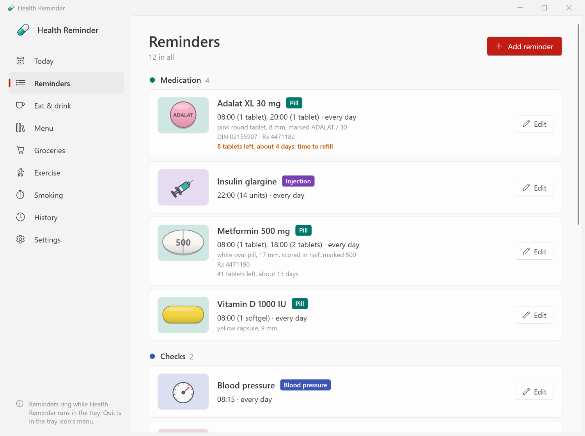

  

[health-reminder](../README.md) › [Manual](README.md) › Reminders

# Reminders

Every reminder, in three groups: **Medication**, **Checks**, and **Meals and drinks**, each with how many it has.

Under the page's title: **5 in all**, or **6 in all, 1 paused**. **Add reminder** opens
[Add a reminder](reminder-editor.md).

## A reminder's card

| | |
|---|---|
| **The picture** | the pill drawn as its label describes it, beside the photo of it when there is one; an icon for the other kinds |
| **The name** and its kind | in the kind's colour: teal for medication, purple for an injection, rose for a blood sugar test, blue for the other checks and for water, orange for a meal |
| **Eating plan** | made by [Eat & drink](eat-drink.md) |
| **On video** | answering it records a video (see [Record taking it](record.md)) |
| **Paused** | it doesn't ring; the card is faded |
| **When** | the times, with the amount at each, and the days: **08:00 (1 tablet), 18:00 (1 tablet) · every day**. With more than six times (a day of drinks), it's summed up: **8 times from 08:00 to 21:30, 2 L a day · every day**. An IV drip: **A bag every 8 h · PICC line, left arm, in since Nov 14 · this bag runs out at 14:30** |
| **What it looks like** | for a pill: **pink round tablet, 8 mm, marked ADALAT / 30** |
| **Its numbers** | **DIN 02155907 · Rx 4471182**, or the NDC for a U.S. product |
| **How many are left** | when it's counted: **24 tablets left, about 24 days**. With a week or less to go it adds **: time to refill**, and the card stands out |
| **Edit** | opens it in [Add a reminder](reminder-editor.md), to change or delete it |

In each group, the reminders are in order of name, paused ones last.

With no reminders yet the page says **No reminders yet. Add one with the button above.**

← [Today](today.md) · [Contents](README.md) · [Add a reminder](reminder-editor.md) →

<!-- strongthium-links -->

---

<b>Strongthium open-source tools:</b> <a href="https://github.com/strongthium/emudhra-security-patch">eMudhra Security Patch</a> · <a href="https://github.com/strongthium/folder-size">Folder Size</a> · <b>Health Reminder</b> · <a href="https://github.com/strongthium/host-dossier">Host Dossier</a> · <a href="https://github.com/strongthium/outbound-watch">Outbound Watch</a> · <a href="https://github.com/strongthium/raw-convert">RAW Convert</a> · <a href="https://github.com/strongthium/video-dispatch">Video Dispatch</a> · <a href="https://github.com/strongthium/webdav-server">WebDAV Server</a> 
<b>More from Strongthium:</b> <a href="https://strongthium.com/linux-server-firewall">Guard</a> · <a href="https://strongthium.com/self-hosted-mail-server">Mail</a> · <a href="https://strongthium.com/self-hosted-live-chat">Chat</a> · <a href="https://strongthium.com/windows-ssh-client">Remote</a> · <a href="https://strongthium.com/twilio-sms-desktop-app">SMS</a> · <a href="https://strongthium.com/time-tracking-invoicing-software">Work</a> · <a href="https://strongthium.com/windows-registry-editor">Registry</a> · <a href="https://strongthium.com/cfml-server">DotCF</a> · <a href="https://strongthium.com/video-conferencing-dial-up-modem">Convey</a> 
<a href="https://strongthium.com">Strongthium Labs</a> · Take back control of your internet.

