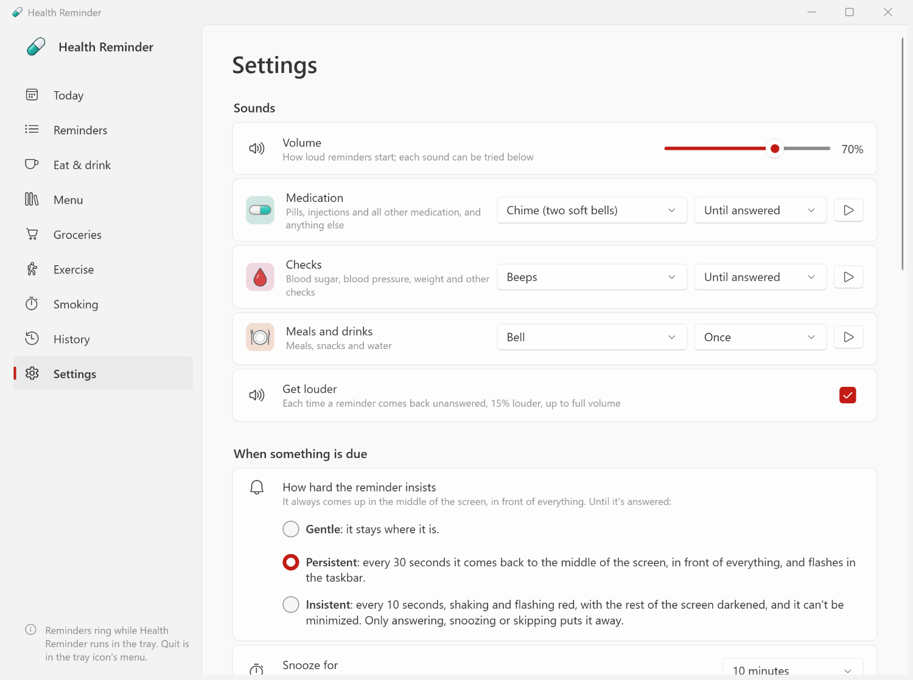
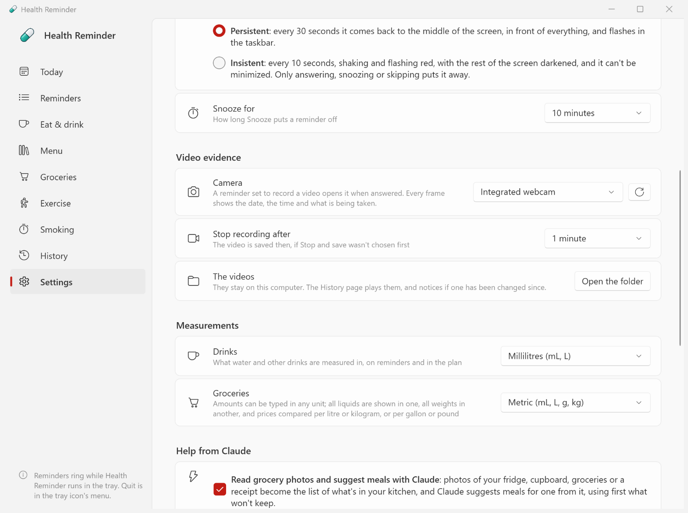

  

[health-reminder](../README.md) › [Manual](README.md) › Settings

# Settings

Tracking, the sounds, how hard a reminder insists, the camera, how things are measured, Help from Claude, and
start-up. Each setting is a card, its control on the right; what's changed is kept at once.

## Tracking

**Tracking is on** (**What's due rings, and what isn't answered counts as missed.**) or **Tracking is stopped**
(**Nothing counts as missed until you start again.**), with **The stats count from Nov 3.** after a reset.

| | |
|---|---|
| **Stop tracking…** | for a stretch you're not following it: see [Stop tracking](stop-tracking.md). While it's stopped, the button is **Start tracking** |
| **Reset stats…** | asks, then starts the stats and what's been missed afresh from now. Nothing else changes, and nothing is deleted |
| **Count everything again** | after a reset: undoes it, and the stats count the days before it again |

## Sounds

| | |
|---|---|
| **Volume** | how loud reminders start, 5% to 100% (80% to begin with) |
| **Medication** | pills, injections and all other medication, and anything else |
| **Checks** | blood sugar, blood pressure, weight and other checks |
| **Meals and drinks** | meals, snacks and water; the kitchen and exercise alerts and the kitchen check use it too |
| **Get louder** | each time a reminder comes back unanswered, 15% louder, up to full volume. On to begin with |

Each group has its own sound, so that it can be told apart by ear:

| | |
|---|---|
| The sound | **Chime (two soft bells)**, **Bell**, **Rising notes**, **Beeps**, **Alarm clock (loud)**, **Siren (very loud)**, **My own sound file (.wav)** or **No sound**. To begin with: a chime for medication, beeps for checks, a bell for meals and drinks |
| **Until answered** or **Once** | whether it repeats until answered; medication and checks repeat to begin with, meals and drinks sound once |
| **▷** | plays it for a few seconds at the volume set |
| **Choose a .wav file…** | for **My own sound file (.wav)**: the file to play. Until one is chosen, or if it can't be read, the chime plays |

## When something is due

| | |
|---|---|
| **How hard the reminder insists** | **Gentle**: it stays where it is. **Persistent** (to begin with): every 30 seconds it comes back to the middle of the screen, in front of everything, and flashes in the taskbar. **Insistent**: every 10 seconds, shaking and flashing red, with the rest of the screen darkened, and it can't be minimized. Only answering, snoozing or skipping puts it away. See [The reminder](alarm.md) |
| **Snooze for** | how long **Snooze** puts a reminder off: **5 minutes**, **10 minutes** (to begin with), **15 minutes**, **30 minutes** or **1 hour** |

## Video evidence

| | |
|---|---|
| **Camera** | the webcam that records the videos (see [Record taking it](record.md)); the refresh button looks for cameras again. **No camera found** when there's none |
| **Stop recording after** | **30 seconds**, **1 minute** (to begin with), **2 minutes** or **5 minutes**: the video is saved then, if **Stop and save** wasn't chosen first |
| **The videos** | they stay on this computer; the [History](history.md) page plays them, and notices if one has been changed since. **Open the folder** opens it |

## Measurements

| | |
|---|---|
| **Drinks** | what water and other drinks are measured in, on reminders, alarms and the plan: **Millilitres (mL, L)**, **Fluid ounces (fl oz)** or **Cups**. They're kept in millilitres, so changing it changes nothing else |
| **Groceries** | amounts can be typed in any unit; all liquids are shown in one, all weights in another, and prices compared per litre or kilogram, or per gallon or pound: **Metric (mL, L, g, kg)** or **U.S. (fl oz, gal, oz, lb)** |
| **Fridge and freezer** | how cold they're set, in **°C** or **°F**: the kitchen's best-before dates are worked out from it. 4 °C (40 °F) and −18 °C (0 °F), the standard, to begin with |

The units start as your country's: metric, millilitres and °C; or, in the U.S. and the other countries not on metric,
U.S. units, fluid ounces and °F.

Warmer than the standard, food keeps less long, and the dates are shortened: roughly half as long in the fridge for every
5 °C (9 °F) over 4 °C, and half as long in the freezer for every 4 °C (7 °F) over −18 °C. A warning says so (**The fridge
is warmer than 4 °C: bacteria grow faster above it, so food keeps less long, and its dates are shortened. Turn it
colder.**), at 0 °C or below that food in the fridge can freeze, and when the freezer is too warm to keep food frozen
solid. A colder setting isn't taken to keep food longer.

## Help from Claude

| | |
|---|---|
| **Read grocery photos and suggest meals with Claude** | photos of your fridge, cupboard, groceries or a receipt become the list of what's in your kitchen, and Claude suggests meals for one from it, using first what won't keep |
| **The key** | your own Anthropic API key, from [console.anthropic.com](https://console.anthropic.com) (it starts `sk-ant-`). **Save the key** keeps it and turns this on; **Remove it** forgets it |

Under the box it says **Save a key first to turn it on.**, or **A key ending in …a1B2 is saved. It uses
claude-opus-5-5.** (or **It's off.**). A key that doesn't start `sk-ant-`: **That doesn't look like an Anthropic API key:
they start with sk-ant-.**

When it's used, the photos, the list of food in your kitchen and the meal's calories are sent to Anthropic, the maker of
Claude; nothing about your medication or health. What's used is billed to your Anthropic account. The key is kept on
this computer, encrypted for your Windows account. It's off until a key is saved.

With it on:

- [Groceries](groceries.md): **From photos…** lists what's in photos of the fridge, the cupboard or a receipt.
- [Menu](menu.md): **Ask Claude** gives three ideas from what's in your kitchen.
- [The reminder](alarm.md): a meal's **Other ideas from my kitchen** gives three other meals to have instead.

## Start-up and data

| | |
|---|---|
| **Start when I sign in to Windows** | it starts in the tray, and comes up when something is due (see [Installing and updating](installing.md)) |
| **Closing the window** | what the main window's **✕** does: **Ask each time** (to begin with), **Keep it running in the tray**, or **Quit Health Reminder**. In the tray it keeps ringing when something is due; after quitting, nothing rings until it's opened again |
| **Your data** | where your reminders, readings, photos and videos are kept, on this computer only. **Open the folder** opens it (see [Your data](your-data.md)) |

## About

The version, and a word on where pills' descriptions and photos come from: the labels manufacturers file with the U.S.
FDA (DailyMed, U.S. National Library of Medicine) and Health Canada's Drug Product Database, with RxNorm saying which
products are the same drug. It's a help, not a guarantee: if a pill doesn't match, check with your pharmacist before
taking it. Health Reminder is not a medical device; don't rely on it alone for medication that is dangerous to miss.

← [Print](print.md) · [Contents](README.md) · [Stop tracking](stop-tracking.md) →

<!-- strongthium-links -->

---

<b>Strongthium open-source tools:</b> <a href="https://github.com/strongthium/emudhra-security-patch">eMudhra Security Patch</a> · <a href="https://github.com/strongthium/folder-size">Folder Size</a> · <b>Health Reminder</b> · <a href="https://github.com/strongthium/host-dossier">Host Dossier</a> · <a href="https://github.com/strongthium/outbound-watch">Outbound Watch</a> · <a href="https://github.com/strongthium/raw-convert">RAW Convert</a> · <a href="https://github.com/strongthium/video-dispatch">Video Dispatch</a> · <a href="https://github.com/strongthium/webdav-server">WebDAV Server</a> 
<b>More from Strongthium:</b> <a href="https://strongthium.com/linux-server-firewall">Guard</a> · <a href="https://strongthium.com/self-hosted-mail-server">Mail</a> · <a href="https://strongthium.com/self-hosted-live-chat">Chat</a> · <a href="https://strongthium.com/windows-ssh-client">Remote</a> · <a href="https://strongthium.com/twilio-sms-desktop-app">SMS</a> · <a href="https://strongthium.com/time-tracking-invoicing-software">Work</a> · <a href="https://strongthium.com/windows-registry-editor">Registry</a> · <a href="https://strongthium.com/cfml-server">DotCF</a> · <a href="https://strongthium.com/video-conferencing-dial-up-modem">Convey</a> 
<a href="https://strongthium.com">Strongthium Labs</a> · Take back control of your internet.

