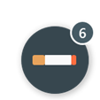

  

[health-reminder](../README.md) › [Manual](README.md) › Log a cigarette

# Log a cigarette

A round button that stays on top of everything, to log a cigarette with one click wherever you are. It's switched on
with **Show a button on top of everything** on the [Smoking](smoking.md) page.

| | |
|---|---|
| **A click** | logs a cigarette. With **Time each one** on, a click when you light one starts it (the button shows how long it's been going: **4:12**), and a click when it's out finishes it |
| **The number** | how many today. It turns dark red once the day's goal is reached, while cutting down |
| **Dragging** | moves it anywhere on the screen; it stays where it's left, and starts there next time |
| **Hovering** | says what a click does, how long since the last one (**Last one 1 h 12 min ago, at 09:40**), and today against yesterday by the same time: **4 today (goal 16); 3 by this time yesterday: 1 more** |

A click counts once: a double-click, or another click within a second and a half, is the same cigarette. The button
is pressed in for that moment.

Right-click it for:

| | |
|---|---|
| **Undo the last one** | |
| **Open the Smoking page** | |
| **Open Stats** | |
| **Hide this button** | the same as unticking it on the Smoking page |

To begin with it's at the right edge of the screen, a little below the middle.

← [Smoking](smoking.md) · [Contents](README.md) · [Stats](stats.md) →

<!-- strongthium-links -->

---

<b>Strongthium open-source tools:</b> <a href="https://github.com/strongthium/emudhra-security-patch">eMudhra Security Patch</a> · <a href="https://github.com/strongthium/folder-size">Folder Size</a> · <b>Health Reminder</b> · <a href="https://github.com/strongthium/host-dossier">Host Dossier</a> · <a href="https://github.com/strongthium/outbound-watch">Outbound Watch</a> · <a href="https://github.com/strongthium/raw-convert">RAW Convert</a> · <a href="https://github.com/strongthium/video-dispatch">Video Dispatch</a> · <a href="https://github.com/strongthium/webdav-server">WebDAV Server</a> 
<b>More from Strongthium:</b> <a href="https://strongthium.com/linux-server-firewall">Guard</a> · <a href="https://strongthium.com/self-hosted-mail-server">Mail</a> · <a href="https://strongthium.com/self-hosted-live-chat">Chat</a> · <a href="https://strongthium.com/windows-ssh-client">Remote</a> · <a href="https://strongthium.com/twilio-sms-desktop-app">SMS</a> · <a href="https://strongthium.com/time-tracking-invoicing-software">Work</a> · <a href="https://strongthium.com/windows-registry-editor">Registry</a> · <a href="https://strongthium.com/cfml-server">DotCF</a> · <a href="https://strongthium.com/video-conferencing-dial-up-modem">Convey</a> 
<a href="https://strongthium.com">Strongthium Labs</a> · Take back control of your internet.

