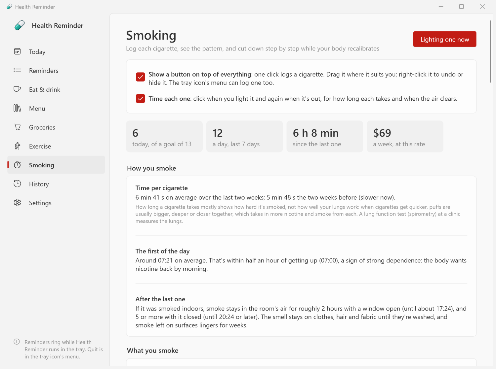
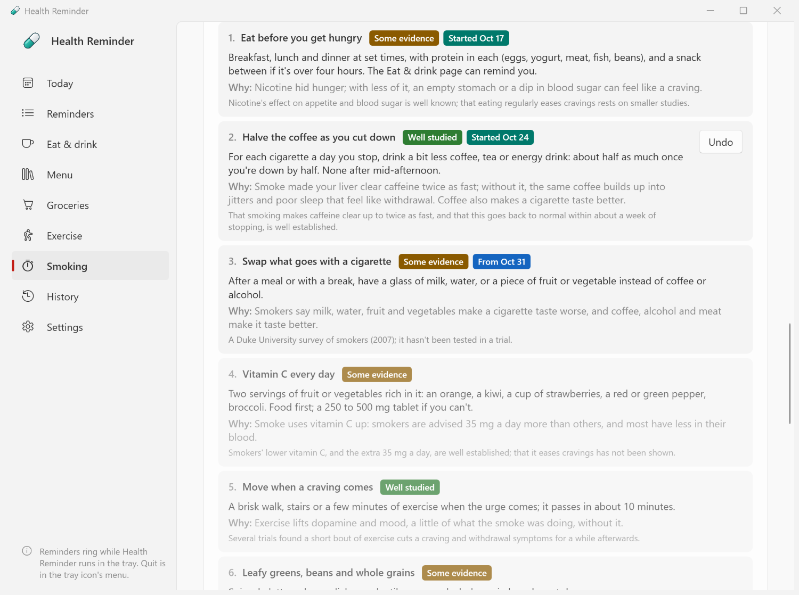

  

[health-reminder](../README.md) › [Manual](README.md) › Smoking

# Smoking

Log each cigarette, see the pattern, and cut down step by step while your body recalibrates.

## At the top

| | |
|---|---|
| **Print** | the numbers, a chart of cigarettes a day and of the time between them, and each day's count, first and last, over the last 7, 14 or 30 days ([Print](print.md)) |
| **Log one now** | logs a cigarette now. With **Time each one** on it says **Lighting one now**, and then **It's out** while one is going |

## How it's logged

| | |
|---|---|
| **Show a button on top of everything** | one click logs a cigarette, from anywhere: see [Log a cigarette](smoke-button.md). The tray icon's menu can log one too |
| **Time each one** | click when you light it and again when it's out, for how long each takes and when the air clears |

## The numbers

| | |
|---|---|
| **today** | how many today; **today, of a goal of 16** while cutting down |
| **a day, last 7 days** | the average |
| **since the last one** | **1 h 12 min** |
| **a week, at this rate** | what it costs, when the price of a pack is filled in below |

## How you smoke

| | |
|---|---|
| **Time per cigarette** | with **Time each one** on: **5 min 40 s on average over the last two weeks; 6 min 10 s the two weeks before (quicker now).** How long a cigarette takes mostly shows how hard it's smoked, not how well your lungs work: quicker usually means bigger, deeper or closer puffs, which take in more. A lung function test (spirometry) measures the lungs |
| **The first of the day** | **Around 07:22 on average.** With when you get up from [Eat & drink](eat-drink.md): within half an hour of getting up is a sign of strong dependence; the longer the wait, the less dependent |
| **After the last one** | when the smoke will have cleared from a room: roughly 2 hours with a window open, 5 or more closed, with the times; on clothes, hair and fabric, until they're washed |

## What you smoke

| | |
|---|---|
| **Brand**, **Cigarettes a pack**, **Price of a pack** | for the cost a week |
| **Tar**, **Nicotine**, **Carbon monoxide** | in mg a cigarette, if your pack prints them |
| **Save** | **Saved.**, or **The price isn't a number.** |
| **What's in the smoke of one cigarette** | no public database lists every chemical by brand, so these are typical amounts in one cigarette's smoke across brands (Health Canada's intense machine-smoking method), each with what it does. With your pack's numbers filled in, it says those first |

## Cutting down

Rather than all at once: fewer cigarettes each week, and one change a week to eating, drinking or moving, each working
against something the smoke does in the body.

| | |
|---|---|
| **A goal** | **Cut down by** **1 a day**, **2 a day**, **3 a day** or **5 a day** **each week**. Pick how fast, then tick it: it starts from how much you smoke now. **Started Nov 5 at about 18 a day. This week, no more than 16 a day; none from about …** The [button on top](smoke-button.md) and the [Stats](stats.md) show the day against it |
| **What the smoke does in your body** | beyond habit, the ways it acts on the body that a craving can come from: harman and norharman blocking the enzymes that break down dopamine and serotonin, nicotine hiding hunger and moving blood sugar, the vitamins it uses up, caffeine cleared about twice as fast, and the taste of food and drink with it |
| **One step a week** | the steps, one at a time, a week apart, so each has time to settle and you can tell what helps; each kept going as the next is added. Each has what to do, **Why:**, how strong the evidence is (**Well studied**, **Some evidence**, **Early evidence**), what the studies found, and any caution. **This week** marks the one that's due; **Start it** starts it, **Undo** takes back the last one started; started ones say **Started Nov 5**, the next **From Nov 26** |

The steps, in order: eat before you get hungry (set meal times, protein in each); halve the coffee as you cut down;
swap what goes with a cigarette (milk, water, fruit instead of coffee or alcohol); vitamin C every day, from food first;
move when a craving comes; leafy greens, beans and whole grains; fish twice a week; something sweet for a sudden
craving. The page warns against beta-carotene and vitamin A supplements, which raised lung cancer in smokers in two
large trials.

Under the steps: smoking speeds up how fast the body clears some medicines (clozapine, olanzapine, theophylline,
caffeine), so cutting down can raise their levels: tell your doctor or pharmacist. And the free quit lines: in Canada,
1-866-366-3667; in the U.S., 1-800-QUIT-NOW (1-800-784-8669).

**Other help: nicotine replacement and medicines**, folded away, has nicotine replacement matched to how much you
smoke (**Matched to about 15.7 a day, the first 22 min after getting up:**), each with its dose and how to use it, for
anyone who wants a bridge on hard days. It's sold without a prescription; ask a doctor first if you're pregnant or
have had a recent heart attack or stroke.

## Today and yesterday

**Each day this week: today 3 · Wed 17 · Tue 14 …**, then each cigarette of today and yesterday: when, and how long it
took (**5 min 40 s**), **lit, not yet out**, or **not timed**. The bin deletes one. With none: **Nothing logged today or
yesterday.**

← [Time to exercise](exercise-alert.md) · [Contents](README.md) · [Log a cigarette](smoke-button.md) →

<!-- strongthium-links -->

---

<b>Strongthium open-source tools:</b> <a href="https://github.com/strongthium/emudhra-security-patch">eMudhra Security Patch</a> · <a href="https://github.com/strongthium/folder-size">Folder Size</a> · <b>Health Reminder</b> · <a href="https://github.com/strongthium/host-dossier">Host Dossier</a> · <a href="https://github.com/strongthium/outbound-watch">Outbound Watch</a> · <a href="https://github.com/strongthium/raw-convert">RAW Convert</a> · <a href="https://github.com/strongthium/video-dispatch">Video Dispatch</a> · <a href="https://github.com/strongthium/webdav-server">WebDAV Server</a> 
<b>More from Strongthium:</b> <a href="https://strongthium.com/linux-server-firewall">Guard</a> · <a href="https://strongthium.com/self-hosted-mail-server">Mail</a> · <a href="https://strongthium.com/self-hosted-live-chat">Chat</a> · <a href="https://strongthium.com/windows-ssh-client">Remote</a> · <a href="https://strongthium.com/twilio-sms-desktop-app">SMS</a> · <a href="https://strongthium.com/time-tracking-invoicing-software">Work</a> · <a href="https://strongthium.com/windows-registry-editor">Registry</a> · <a href="https://strongthium.com/cfml-server">DotCF</a> · <a href="https://strongthium.com/video-conferencing-dial-up-modem">Convey</a> 
<a href="https://strongthium.com">Strongthium Labs</a> · Take back control of your internet.

