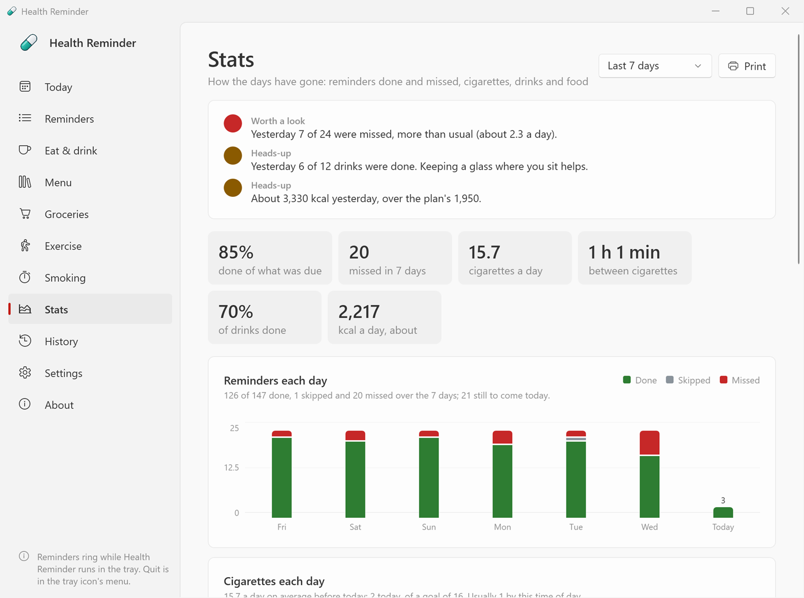
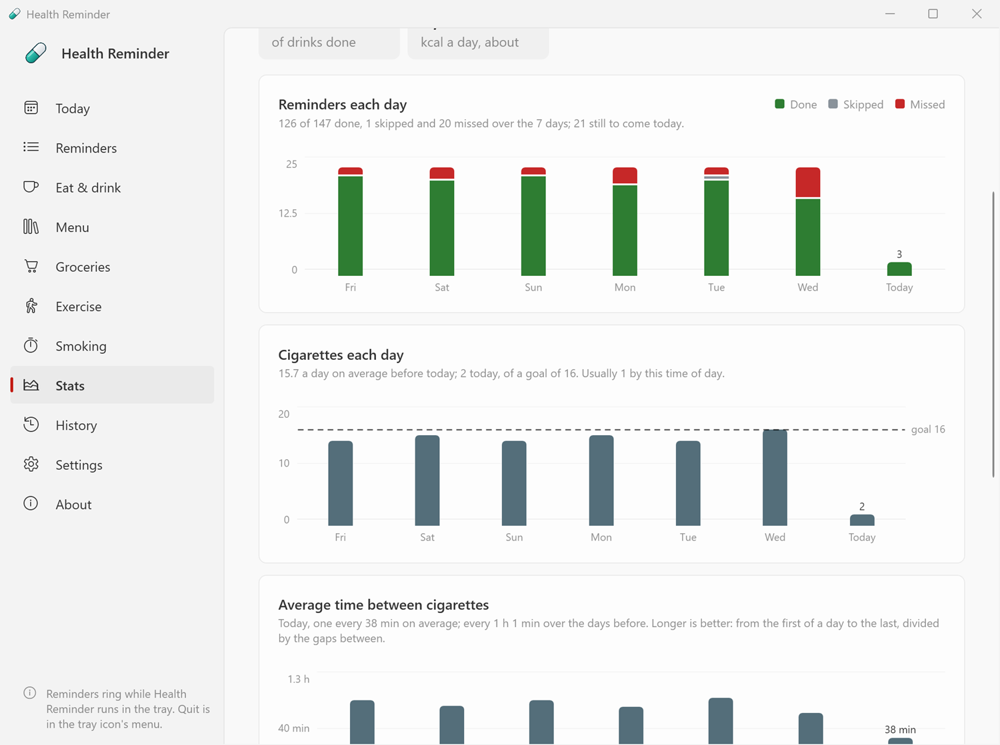

  

[health-reminder](../README.md) › [Manual](README.md) › Stats

# Stats

How the days have gone: reminders done and missed, cigarettes, drinks and food, a bar a day, with a word on what
stands out.

## At the top

| | |
|---|---|
| **Last 7 days** | or **Last 14 days**, or **Last 30 days**; it's remembered |
| **Print** | puts the stats on paper or in a PDF, to take to a doctor ([Print](print.md)) |
| Under the title | **Counting from Nov 3.** after the stats were reset, or **Tracking is stopped: nothing counts as missed until it's started again.** |

## What stands out

Notes worked out from the days before, each marked **Worth a look**, **Heads-up** or **Good**. What's usual is the week
before yesterday, so a bad day doesn't count against itself. The first three are on [Today](today.md) too.

| | |
|---|---|
| A medication missed today | **Medication missed today: Adalat XL 30 mg at 08:00. If a dose is missed often, a pharmacist can say what to do when it happens.** |
| Others missed today | **2 missed today so far: Water at 11:00 and Water at 13:00.** |
| More missed than usual | **Yesterday 7 of 24 were missed, more than usual (about 2.3 a day).** |
| Missed often | **9 of 160 missed over the last 7 days (5%). Moving the times to when you're usually free, or a longer snooze, may help.** |
| Over the day's goal | **17 cigarettes today, over today's goal of 16.** |
| More, or fewer, by this time | **12 cigarettes by 15:20, about 3 more than usual by this time (8.6).** |
| More yesterday | **Yesterday 21 cigarettes, more than your usual 15.7 a day.** |
| Closer together | **Closer together today: one every 44 min on average, against every 1 h 8 min usually.** |
| Few drinks | **Yesterday 6 of 12 drinks were done. Keeping a glass where you sit helps.** |
| Over the plan | **About 3,330 kcal yesterday, over the plan's 1,950.** |

With nothing to say: **Nothing stands out: what's missed, smoked and drunk is about as usual.**, or **Not much logged
yet: notes come as the days fill in.**

## The numbers

| | |
|---|---|
| **85%** **done of what was due** | the reminders done of those due over the days |
| **20** **missed in 7 days** | or **missed today**, over a single day |
| **15.7** **cigarettes a day** | |
| **1 h 1 min** **between cigarettes** | on average, from the first of a day to the last |
| **70%** **of drinks done** | the drinks done of those planned |
| **2,217** **kcal a day, about** | |

## The charts

A bar a day, today last:

| | |
|---|---|
| **Reminders each day** | done, skipped and missed, in green, grey and red: **126 of 147 done, 1 skipped and 20 missed over the 7 days; 21 still to come today.** |
| **Cigarettes each day** | with the goal as a dashed line while cutting down: **15.7 a day on average before today; 2 today, of a goal of 16. Usually 1 by this time of day.** |
| **Average time between cigarettes** | longer is better: from the first of a day to the last, divided by the gaps between |
| **Drinks each day** | done and not done, against the day's drinks planned |
| **Calories each day** | from the meals marked eaten (their recipe's, or the plan's) and the food logged, with the plan as a line |

Hovering over a bar says that day's numbers.

## How it's counted

A meal marked eaten counts its recipe's calories if the [Menu](menu.md) had one for it, or the eating plan's. Food
logged by hand counts its own ([Log food](log-food.md)). What's missed is what was neither done nor skipped by 12
hours after its time, or by the next dose of the same reminder. While tracking is stopped nothing counts as missed;
after a reset, everything counts from then (see [Stop tracking](stop-tracking.md)).

← [Log a cigarette](smoke-button.md) · [Contents](README.md) · [Print](print.md) →

<!-- strongthium-links -->

---

<b>Strongthium open-source tools:</b> <a href="https://github.com/strongthium/emudhra-security-patch">eMudhra Security Patch</a> · <a href="https://github.com/strongthium/folder-size">Folder Size</a> · <b>Health Reminder</b> · <a href="https://github.com/strongthium/host-dossier">Host Dossier</a> · <a href="https://github.com/strongthium/outbound-watch">Outbound Watch</a> · <a href="https://github.com/strongthium/raw-convert">RAW Convert</a> · <a href="https://github.com/strongthium/video-dispatch">Video Dispatch</a> · <a href="https://github.com/strongthium/webdav-server">WebDAV Server</a> 
<b>More from Strongthium:</b> <a href="https://strongthium.com/linux-server-firewall">Guard</a> · <a href="https://strongthium.com/self-hosted-mail-server">Mail</a> · <a href="https://strongthium.com/self-hosted-live-chat">Chat</a> · <a href="https://strongthium.com/windows-ssh-client">Remote</a> · <a href="https://strongthium.com/twilio-sms-desktop-app">SMS</a> · <a href="https://strongthium.com/time-tracking-invoicing-software">Work</a> · <a href="https://strongthium.com/windows-registry-editor">Registry</a> · <a href="https://strongthium.com/cfml-server">DotCF</a> · <a href="https://strongthium.com/video-conferencing-dial-up-modem">Convey</a> 
<a href="https://strongthium.com">Strongthium Labs</a> · Take back control of your internet.

