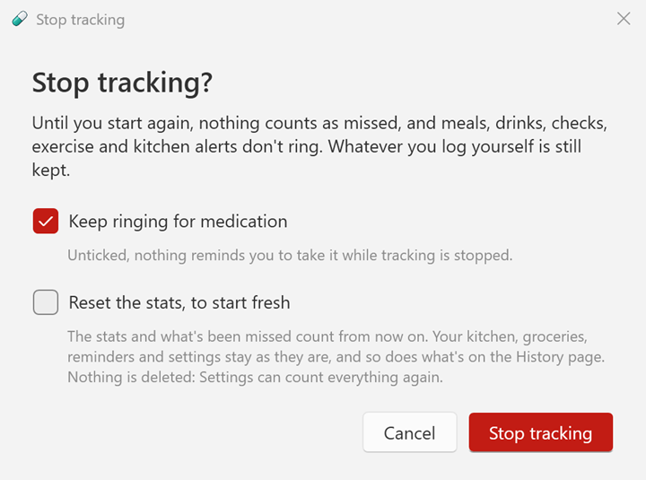

  

[health-reminder](../README.md) › [Manual](README.md) › Stop tracking

# Stop tracking

For a stretch you're not following it: in hospital, on holiday, a week off the plan. **Stop tracking…**, under
**Tracking** in [Settings](settings.md), asks first.

**Stop tracking?** Until you start again, nothing counts as missed, and meals, drinks, checks, exercise and kitchen
alerts don't ring. Whatever you log yourself is still kept.

| | |
|---|---|
| **Keep ringing for medication** | ticked to begin with: medication keeps ringing while tracking is stopped. Unticked, nothing reminds you to take it. Shown when there's medication |
| **Reset the stats, to start fresh** | the stats and what's been missed count from now on. Your kitchen, groceries, reminders and settings stay as they are, and so does what's on the History page. Nothing is deleted: Settings can count everything again |
| **Cancel** | nothing changes |
| **Stop tracking** | stops it |

What's due and unanswered as it stops doesn't go on to count as missed.

While it's stopped, [Today](today.md) says **Tracking is stopped**, with whether medication still rings, and
**Start tracking**; the [Stats](stats.md) say so too, and the tray icon's tip ends in **(tracking stopped)**.
**Start tracking**, there or in Settings, starts it again from then.

**Reset stats…** in Settings does the reset on its own, without stopping, and **Count everything again** undoes a
reset.

← [Settings](settings.md) · [Contents](README.md) · [Close Health Reminder](close.md) →

<!-- strongthium-links -->

---

<b>Strongthium open-source tools:</b> <a href="https://github.com/strongthium/emudhra-security-patch">eMudhra Security Patch</a> · <a href="https://github.com/strongthium/folder-size">Folder Size</a> · <b>Health Reminder</b> · <a href="https://github.com/strongthium/host-dossier">Host Dossier</a> · <a href="https://github.com/strongthium/outbound-watch">Outbound Watch</a> · <a href="https://github.com/strongthium/raw-convert">RAW Convert</a> · <a href="https://github.com/strongthium/video-dispatch">Video Dispatch</a> · <a href="https://github.com/strongthium/webdav-server">WebDAV Server</a> 
<b>More from Strongthium:</b> <a href="https://strongthium.com/linux-server-firewall">Guard</a> · <a href="https://strongthium.com/self-hosted-mail-server">Mail</a> · <a href="https://strongthium.com/self-hosted-live-chat">Chat</a> · <a href="https://strongthium.com/windows-ssh-client">Remote</a> · <a href="https://strongthium.com/twilio-sms-desktop-app">SMS</a> · <a href="https://strongthium.com/time-tracking-invoicing-software">Work</a> · <a href="https://strongthium.com/windows-registry-editor">Registry</a> · <a href="https://strongthium.com/cfml-server">DotCF</a> · <a href="https://strongthium.com/video-conferencing-dial-up-modem">Convey</a> 
<a href="https://strongthium.com">Strongthium Labs</a> · Take back control of your internet.

