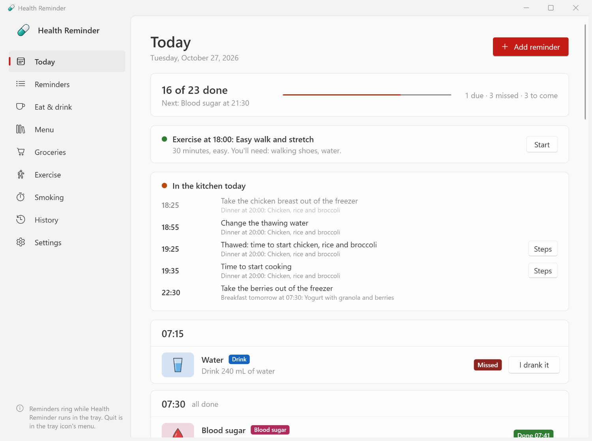
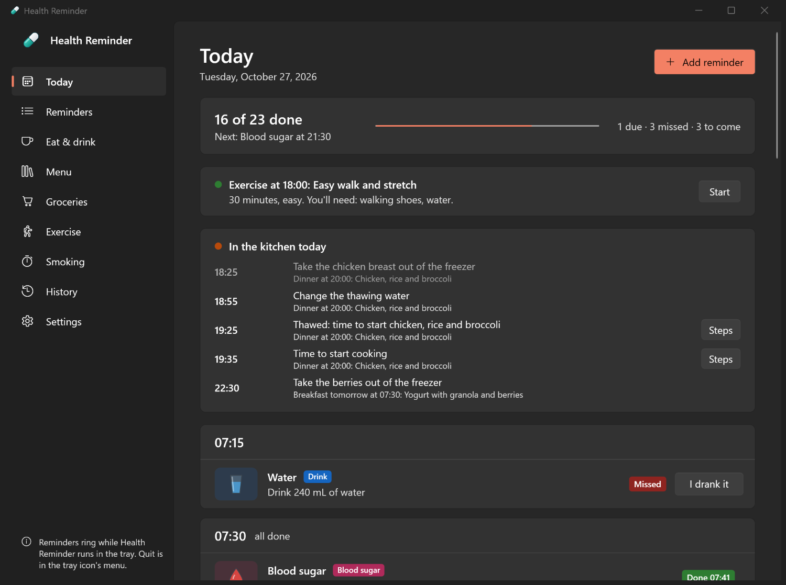

  

[health-reminder](../README.md) › [Manual](README.md) › Today

# Today

The day by time: everything due today, with what became of each, and above it how the day is going, the food logged,
today's exercise and what's happening in the kitchen. Anything can be answered here as well as on
[the reminder](alarm.md) when it rings.

## At the top

| | |
|---|---|
| **Today** and the date | |
| **Add reminder** | opens [Add a reminder](reminder-editor.md) |

## The cards

**Eaten today** is always there; the others show only when they have something to say.

| | |
|---|---|
| **Tracking is stopped** | while tracking is stopped (see [Stop tracking](stop-tracking.md)): nothing counts as missed, and it says whether medication still rings. **Start tracking** starts it again |
| **How the day is going** | **3 of 8 done**, with what's next (**Next: Blood sugar at 21:30**, or **Nothing more is scheduled**), a bar of what's been answered, and how many are due, snoozed, missed, skipped and still to come |
| **What stands out** | up to three notes from the [Stats](stats.md) (a medication missed, more cigarettes than usual by this time of day…); **Stats** opens that page |
| **Eaten today** | **About 1,240 kcal eaten today**, from the meals marked eaten and the food logged, against the eating plan's calories. **Log food** opens [Log food](log-food.md). Below it, each thing logged today: when, what, how much, whether it was from the kitchen or eaten out, and about how many kcal; its **✕** takes it out of the log, and what it took off the kitchen goes back |
| **Exercise** | today's session from the [Exercise](exercise.md) plan: **Exercise at 18:00: Easy walk and stretch**, how long and what you'll need, and **Start**, which opens its steps at the side of the screen. Once it's done: **Exercise done at 18:36**, with how long and the calories |
| **In the kitchen today** | the [kitchen alerts](kitchen-alerts.md) of the day by time: take something out of the freezer, change the thawing water, time to start. **Steps** opens a recipe's steps at the side of the screen. What's done is ticked and faded |

## The day, by time

A card for each time something is due, in order. Its heading is the time and how much of it is left: **all done**,
**3 things**, or **2 of 3 left**. With more than one still to answer, **All done** marks them all done at once.

Each line has:

| | |
|---|---|
| **The picture** | a pill drawn as it looks, as many times as are taken; an icon for everything else |
| **The name** and its kind | **Pill**, **Injection**, **Blood sugar**, **Drink**, **Meal**… in the kind's colour |
| **What to do** | **Take 2 tablets**, **Inject 14 units · Abdomen, left**, **Drink 250 mL of water**; once a check is done, the reading: **6.4 mmol/L** |
| **What became of it** | **Done 07:41**, **Skipped**, **Snoozed to 08:10**, **Due now**, **Missed**, or **Later** for what's still to come |
| **Reading** | for a check: type the reading before answering |
| **The button** | **I took it**, **Injected**, **Save** (a check), **I ate**, **I drank it**, **Bag changed** (an IV drip) or **Done**; **Record taking it** and the like when it records a video (see [Record taking it](record.md)) |

The button is there until it's answered, so a dose marked **Missed** can still be marked done later. An injection
answered here takes the next site in its rotation; a meal marked eaten takes what its recipe uses off
[your kitchen](kitchen.md), if the menu had one for it.

## When there's nothing

| | |
|---|---|
| **Nothing to remind you of yet** | there are no reminders. **Add a medication or check** opens [Add a reminder](reminder-editor.md); **Plan meals and drinks** opens [Eat & drink](eat-drink.md) |
| **Nothing to do today.** | there are reminders, but none today |

The page is brought up to date every minute, and when anything is answered or changed. What's typed in a reading box
stays while it does.

Like every window of the program, it follows Windows' light or dark mode and accent colour.

← [Installing and updating](installing.md) · [Contents](README.md) · [Reminders](reminders.md) →

<!-- strongthium-links -->

---

<b>Strongthium open-source tools:</b> <a href="https://github.com/strongthium/emudhra-security-patch">eMudhra Security Patch</a> · <a href="https://github.com/strongthium/folder-size">Folder Size</a> · <b>Health Reminder</b> · <a href="https://github.com/strongthium/host-dossier">Host Dossier</a> · <a href="https://github.com/strongthium/outbound-watch">Outbound Watch</a> · <a href="https://github.com/strongthium/raw-convert">RAW Convert</a> · <a href="https://github.com/strongthium/video-dispatch">Video Dispatch</a> · <a href="https://github.com/strongthium/webdav-server">WebDAV Server</a> 
<b>More from Strongthium:</b> <a href="https://strongthium.com/linux-server-firewall">Guard</a> · <a href="https://strongthium.com/self-hosted-mail-server">Mail</a> · <a href="https://strongthium.com/self-hosted-live-chat">Chat</a> · <a href="https://strongthium.com/windows-ssh-client">Remote</a> · <a href="https://strongthium.com/twilio-sms-desktop-app">SMS</a> · <a href="https://strongthium.com/time-tracking-invoicing-software">Work</a> · <a href="https://strongthium.com/windows-registry-editor">Registry</a> · <a href="https://strongthium.com/cfml-server">DotCF</a> · <a href="https://strongthium.com/video-conferencing-dial-up-modem">Convey</a> 
<a href="https://strongthium.com">Strongthium Labs</a> · Take back control of your internet.

